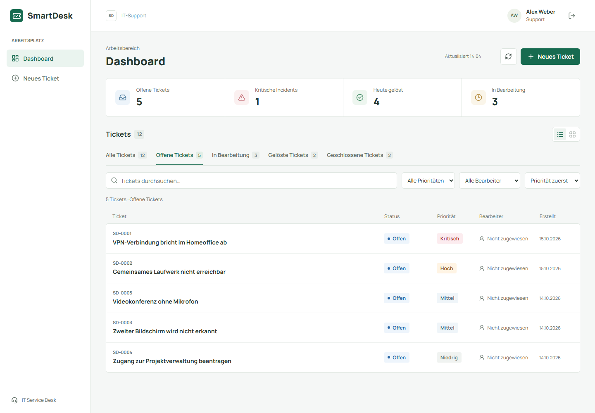
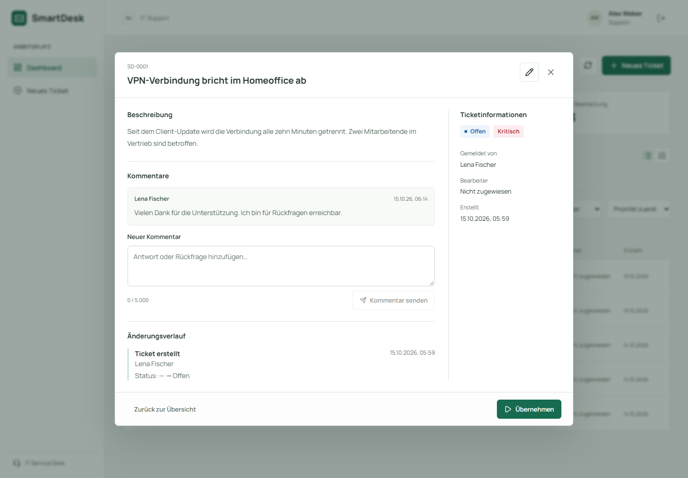
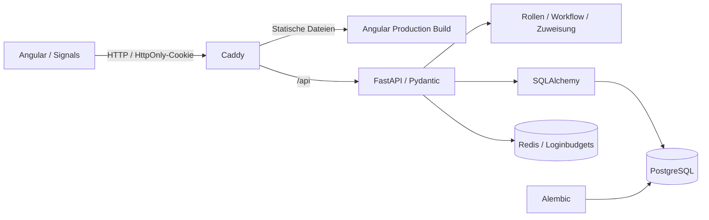

# SmartDesk

[](https://github.com/okankpl/SmartDesk/actions/workflows/backend-tests.yml)
[](https://github.com/okankpl/SmartDesk/actions/workflows/frontend-tests.yml)
[](https://github.com/okankpl/SmartDesk/actions/workflows/demo-e2e.yml)

Ein Full-Stack-Projekt für internen IT-Support: Mitarbeitende melden Anliegen, Agents übernehmen die Bearbeitung und Admins prüfen den Abschluss. SmartDesk verbindet **Angular, FastAPI und PostgreSQL** mit rollenbasierten Zugriffsregeln, einem geregelten Ticket-Lebenszyklus und einer nachvollziehbaren Änderungshistorie.



[Mobile Ansicht ansehen](docs/images/mobile.png)

**Live-Demo:** [smartdesk-okan.duckdns.org](https://smartdesk-okan.duckdns.org) – auf der Anmeldeseite **Demo starten** wählen. Jede Person erhält einen eigenen Arbeitsbereich mit Beispieltickets, kann zwischen den drei Rollen wechseln und sieht keine Eingaben anderer Besucher; der Bereich wird nach 24 Stunden gelöscht.

**Dokumentation:** [Architektur, technische Entscheidungen und Betrieb](docs/README.md). Für den ersten Eindruck genügt die Demo unten; die technischen Dokumente erklären die Umsetzung und ihre Grenzen.

## Demo starten

Voraussetzung: **Docker mit Compose**, beispielsweise Docker Desktop. Im Projektverzeichnis:

```bash
docker compose -f docker-compose.demo.yml up -d --build
```

Anschließend **[localhost:8080](http://localhost:8080)** öffnen. Der erste Build lädt die Abhängigkeiten; Migrationen und Demo-Daten werden automatisch angelegt. Weder Node.js noch Python oder eine `.env` sind für diese Demo nötig.

| Rolle | E-Mail | Was sich ausprobieren lässt |
| --- | --- | --- |
| Mitarbeitende | `employee@example.com` | Eigene Tickets erstellen, kommentieren und Lösungen ablehnen |
| Support | `agent@example.com` | Gesamte Warteschlange sehen, Tickets übernehmen und eigene Bearbeitungen lösen |
| Administration | `admin@example.com` | Bearbeiter zuweisen, eingreifen und gelöste Tickets final schließen |

**Passwort für alle drei Demo-Konten:** `SmartDesk-Demo26!`

Die Demo enthält zwölf fiktive Supportfälle in allen vier Status mit Kommentaren und Historie. Zusätzlich bietet die Anmeldeseite **Demo starten**: ein eigener Arbeitsbereich ohne Konto mit Rollenwechsel, so wie ihn eine öffentliche Demo-Instanz verwendet (siehe [Architektur](docs/architektur-und-konzepte.md#öffentliche-demo-private-arbeitsbereiche)). Die bekannte Anmeldung gilt ausschließlich für diesen lokal gebundenen Demo-Stack. Er nutzt ein eigenes Volume und verändert die Entwicklungsdatenbank nicht. Ein erneuter Start erhält die Daten; die Befüllung überschreibt keine bestehenden Konten.

**Kurzer Rundgang:** Als Support ein offenes Ticket übernehmen und unter „In Bearbeitung“ lösen. Als Mitarbeitende kann die Lösung abgelehnt werden; als Admin lässt sie sich final schließen. Im Detaildialog sind Autorennamen, Bearbeiter und der Änderungsverlauf sichtbar.

```bash
# Demo stoppen, Daten behalten
docker compose -f docker-compose.demo.yml down

# Demo vollständig zurücksetzen: entfernt die Demo-Volumes, also auch Konten,
# die Browsertests oder eigene Versuche angelegt haben. Der nächste Start
# legt die zwölf Beispieltickets neu an.
docker compose -f docker-compose.demo.yml down -v
```

API-Dokumentation in der Demo: [localhost:8080/api/docs](http://localhost:8080/api/docs).

## Funktionsumfang

- **Ticket-Workflow:** offen → in Bearbeitung → gelöst → geschlossen; Ablehnung einer Lösung führt zurück in Bearbeitung.
- **Berechtigungen:** Mitarbeitende sehen ausschließlich eigene Tickets. Der Server berechnet die verfügbaren Aktionen pro Ticket und Nutzer und prüft jeden Schreibzugriff erneut.
- **Verbindliche Zuständigkeit:** Übernehmen trägt den Agent ein. Andere Agents können das Ticket weder übernehmen noch lösen; Admins können delegieren und eingreifen.
- **Änderungsverlauf:** Erstellen, Statuswechsel und Änderungen werden mit handelnder Person, Zeitpunkt und Vorher-/Nachher-Werten gespeichert. Ticketänderung und Historieneintrag bilden eine Transaktion.
- **Zusammenarbeit:** Kommentare mit Autorennamen; Inhalte werden als Text dargestellt. Kommentar- und Historienzugriff folgen der Sichtbarkeit des Tickets.
- **Arbeitsoberfläche:** kompakte Listen- oder Kartenansicht, statusübergreifende Suche nach Text/Nummer/Person, kombinierbare Filter und Sortierung nach Priorität oder Datum. Kennzahlen, Ergebniszahlen und leere Ansichten geben direkt Rückmeldung.
- **Bearbeitung ohne Kontextverlust:** Statuswechsel und Zuweisungen halten den Detaildialog offen; ein Kommentarentwurf bleibt dabei erhalten. Beschreibung, Kommentare und Verlauf scrollen gemeinsam, während Kopf und Aktionsleiste sichtbar bleiben.
- **Inhalte bearbeiten:** Support und Administration ändern Titel, Beschreibung und Priorität direkt im Detaildialog. Der Editor schützt vor dem Verwerfen ungespeicherter Änderungen und erkennt veraltete Ticketversionen. Fehlgeschlagene Speicherungen erhalten den Entwurf; erfolgreiche Änderungen erscheinen in der Historie.
- **Konten:** Registrierung und Anmeldung, bcrypt-Passwörter, JWT im HttpOnly-Cookie, Wiederherstellung und Ablauf einer Sitzung.
- **Login-Schutz:** gemeinsame Redis-Zähler pro IP und normalisierter E-Mail, auch über mehrere Backend-Prozesse. Bei ausgeschöpftem Budget zeigt die Anmeldung eine Wartezeit; ein Ausfall des Schutzdienstes erlaubt keine unbegrenzten Login-Versuche.
- **Öffentliche Demo ohne Konto:** „Demo starten“ legt pro Person einen privaten Arbeitsbereich mit Beispieltickets an; ein Knopf wechselt zwischen Mitarbeitenden, Support und Administration, nach 24 Stunden wird alles gelöscht. Die Arbeitsbereiche sind in allen Sichtbarkeitsregeln voneinander getrennt.
- **Betrieb:** automatisierte Migrationen, getrennte Demo-/Test-/Produktionskonfiguration, Non-root-Backend, Caddy, Readiness-Check und Backup-/Deployment-Skripte.



## Technische Entscheidungen



| Entscheidung | Begründung |
| --- | --- |
| Modularer Backend-Monolith | Router, Eingabeschemas, Modelle und Fachregeln haben getrennte Aufgaben, ohne zusätzliche Dienste betreiben zu müssen. |
| PostgreSQL auch für Integrationstests | Fremdschlüssel, JSONB, ENUMs, Zeitzonen und Zeilensperren werden mit derselben Datenbanktechnik geprüft wie im Betrieb. |
| Serverseitige Rollen- und Objektprüfung | Eine ausgeblendete Schaltfläche ist kein Zugriffsschutz; auch direkte API-Anfragen müssen die Regeln einhalten. |
| `SELECT … FOR UPDATE` bei Ticketänderungen | Zwei gleichzeitige Übernahmen werden serialisiert. Nur ein Agent gewinnt; die zweite Anfrage erhält `409`. |
| Gemeinsame Transaktion für Ticket und Ereignis | Fehlgeschlagene Aktionen hinterlassen keinen scheinbar erfolgreichen Historieneintrag. |
| Versionsprüfung bei Inhaltsänderungen | Der Editor sendet die gelesene Ticketversion mit. Ein veralteter Stand wird unter derselben Zeilensperre mit `409` abgewiesen, ohne neuere Inhalte oder die Historie zu überschreiben. |
| Explizite Demo-Befüllung | Bekannte Demo-Zugangsdaten entstehen nur bei `DEMO_MODE=true`, getrennt von der produktiven Konfiguration. |
| Private Demo-Arbeitsbereiche statt gemeinsamer Konten | Öffentlich würden sich Besucher sonst Tickets und Eingaben teilen. Jeder Bereich ist ein eigener Mandant; jede Sichtbarkeitsregel prüft ihn, fremde Bereiche antworten mit `404`. |
| Login-Drosselung mit `limits` und Redis | Atomare Moving-Window-Zähler gelten pro IP und E-Mail unabhängig vom Backend-Prozess. Keine Klartext-E-Mails/IPs in Redis-Schlüsseln; keine dauerhafte Kontosperre. |
| Bedarfsgesteuertes Frontend | Seiten werden als eigene Route-Chunks geladen. Filter, Kennzahlen und Ticketvorschau sind eigenständige Präsentationskomponenten; der Detaildialog lädt Kommentare und Historie erst beim Öffnen. |

Die vollständige [Architektur und Spezifikation](docs/architektur-und-konzepte.md), die [Entscheidungen zu Zuständigkeit und Historie](docs/entscheidungen-workflow-und-historie.md) und die [Deployment-Anleitung](docs/deployment.md) beschreiben Details und Grenzen.

## Qualität prüfen

Backend einschließlich Migrationen, Modelldrift, Unit-/HTTP-Tests, konkurrierender Änderungen, Redis-Rate-Limits und Ruff, mit separaten PostgreSQL-/Redis-Testdiensten:

```bash
docker compose -f docker-compose.demo.yml --profile test run --build --rm tests

# Die Testdatenbank und der Test-Redis laufen danach weiter; das stoppt sie
# (zusammen mit einer eventuell laufenden Demo, deren Daten erhalten bleiben).
docker compose -f docker-compose.demo.yml --profile test down
```

Die Tests verändern keine Demo-Daten. PostgreSQL-Integrationstests benötigen eine explizite `TEST_DATABASE_URL` mit Datenbankname auf `_test`, Redis-Integrationstests `TEST_REDIS_URL`; ohne diese werden die jeweiligen Tests lokal übersprungen. Die CI führt beide aus.

Frontend, mit **Node.js 24** (siehe `frontend/.nvmrc`):

```bash
cd frontend
npm ci
npm test -- --watch=false
npm run build

# Browser-Tests gegen die laufende Demo: Desktop und Mobile
npx playwright install chromium
npm run test:e2e
```

Dokumentation, nach `npm ci` im Frontend, aus dem Projektverzeichnis:

```powershell
# Prüft den Dokumentationsprüfer selbst und danach alle lokalen Verweise.
node --test scripts/check-docs.test.mjs
node scripts/check-docs.mjs
```

GitHub Actions ist für Backendprüfungen mit PostgreSQL, Angular-Tests samt Produktionsbuild, Dokumentationslinks sowie einen frisch gebauten Demo-Stack mit Playwright konfiguriert. TypeScript und Angular-Templates werden im Strict-Modus geprüft. Dependabot ist für npm, Python, Docker und Actions eingerichtet.

## Lokal entwickeln

Die schnelle Demo und die Entwicklungsumgebung sind voneinander getrennt. Für Änderungen mit Live-Reload:

```bash
cp .env.example .env
python -c "import secrets; print(secrets.token_hex(32))"
```

Den erzeugten Wert in `.env` als `SECRET_KEY` eintragen. Der öffentliche Platzhalter wird beim Start absichtlich abgelehnt.

```bash
docker compose up -d --build
docker compose exec backend alembic upgrade head
cd frontend
npm ci
npm start
```

Frontend: [localhost:4200](http://localhost:4200). API: [localhost:8000/docs](http://localhost:8000/docs). Konten lassen sich über `/register` erstellen; neue Konten erhalten immer die Rolle `employee`. Für den sofortigen Vergleich aller Rollen dient die separate Demo.

```text
backend/app/core/       Konfiguration, Auth, Datenbank, Fehlerbehandlung
backend/app/models/     Persistenzmodelle
backend/app/schemas/    API-Verträge und Eingabevalidierung
backend/app/services/   Fachregeln und Historieneinträge
backend/app/routers/    HTTP-Endpunkte
backend/alembic/        Versionierte Datenbankmigrationen
backend/tests/          Unit- und PostgreSQL-Integrationstests
frontend/src/app/       Angular-Seiten, Komponenten und Services
frontend/e2e/           Browser-Tests für Desktop und Mobile
scripts/               Deployment, Backup und Healthcheck
docs/                  Spezifikation, Architektur und Betriebsanleitung
```

## Grenzen und weitere Arbeit

SmartDesk ist ein vorführbares Entwicklungs- und Portfolio-Projekt. Ein öffentliches Live-Deployment ist hier nicht vorausgesetzt. Für einen Einsatz mit echten Nutzerdaten stehen insbesondere E-Mail-Verifikation/Passwort-Reset, Token-Widerruf, Missbrauchsschutz für Registrierung und serverseitige Pagination aus. Die Suche filtert aktuell die bereits rollenbeschränkt geladene Ticketliste im Browser. Die Oberfläche sendet bei Inhaltsänderungen und Zuweisungen immer `expected_version`; direkte API-Clients können dieses Feld aus Kompatibilitätsgründen noch weglassen und erhalten dann keinen Schutz vor veralteten Eingaben.

Der Login erlaubt standardmäßig 30 Anfragen pro IP in 60 Sekunden und 10 pro normalisierter E-Mail in 300 Sekunden, einschließlich erfolgreicher Anmeldungen. Die lokale Demo nutzt 120 beziehungsweise 60, damit gemeinsam verwendete Testkonten vorführbar bleiben. `429` enthält `Retry-After`, bei Redis-Ausfall antwortet der Login mit `503`. Aktive Sitzungen bleiben nutzbar. Ein Angreifer kann das Budget einer bekannten E-Mail vorübergehend verbrauchen; es gibt noch keinen gesonderten Kontowiederherstellungsweg. Konfiguration und Betriebsgrenzen stehen in der [Architektur](docs/architektur-und-konzepte.md#login-drosselung) und der [Betriebsanleitung](docs/deployment.md).

Die Historie ist über die API nur lesbar und beginnt für bestehende Tickets mit Änderungen nach ihrer Einführung. Sie ist kein revisionssicheres Archiv: Datenbank-Administratoren können Daten ändern, und ein Admin kann ein Ticket samt Kommentaren und Historie löschen. [Weitere bewusste Einschränkungen](docs/architektur-und-konzepte.md#9-bewusste-einschränkungen--offene-punkte).

Das Projekt wird mit KI-Unterstützung entwickelt. Technische Entscheidungen, Grenzen und automatisierte Prüfungen sind im Repository nachvollziehbar dokumentiert.
