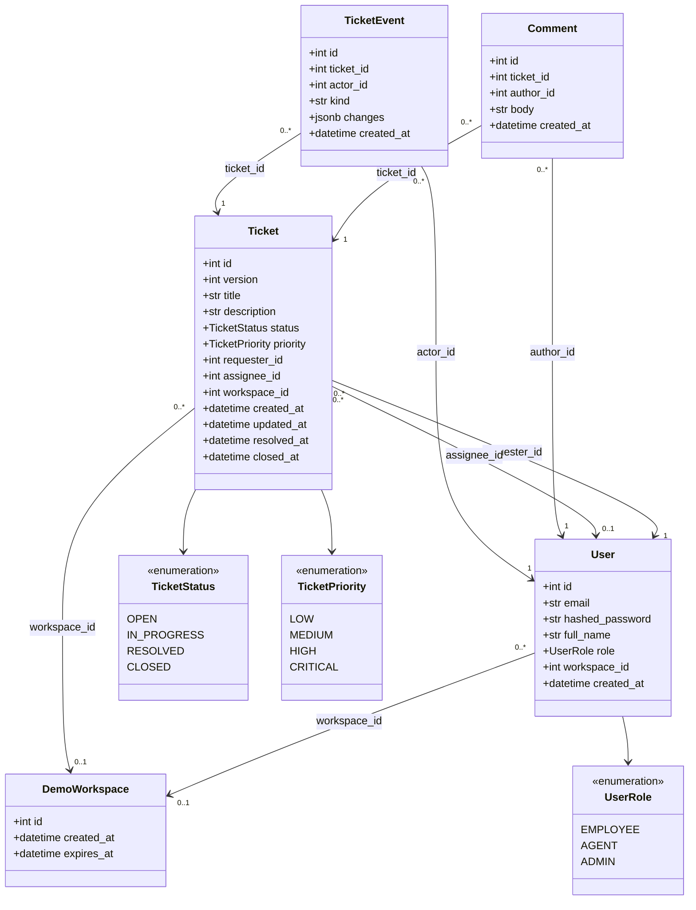
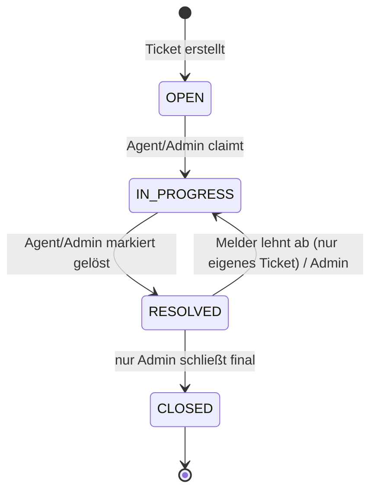
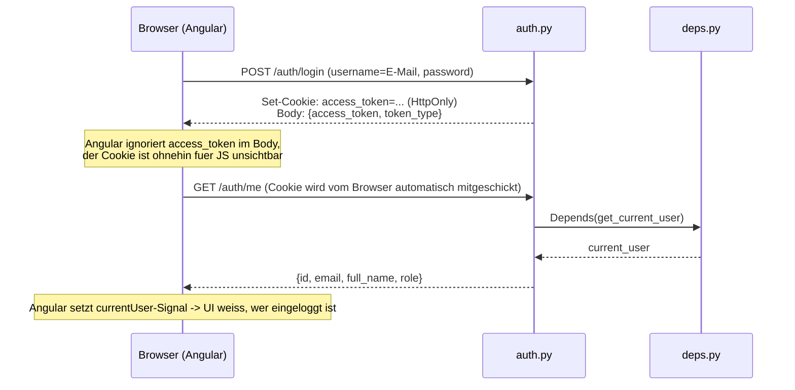

# SmartDesk – Architektur & Konzepte

Diese Datei erklärt **warum** SmartDesk so gebaut ist, wie es gebaut ist, und die wichtigsten technischen Konzepte dahinter – als Referenz für den aktuellen Architekturstand und die Begründung einzelner Entscheidungen.

Die [README.md](../README.md) gibt den schnellen Projekt- und Starteinstieg. Hier geht es um Spezifikation und Architekturentscheidungen. Die [Dokumentationsübersicht](README.md) ordnet die technischen Dokumente ein.

**Abgeglichen am 20.10.2026**, einschließlich Ticketeditor, Anwendungshistorie, Versionsschutz, Login-Drosselung und privater Demo-Arbeitsbereiche. Aktueller Migrationskopf: `ccca87eb18e9`.

**Inhalt:**
1. [Der große Überblick](#1-der-große-überblick)
2. [Spezifikation: was SmartDesk leisten soll](#2-spezifikation-was-smartdesk-leisten-soll)
3. [Tech-Stack: was und warum](#3-tech-stack-was-und-warum)
4. [Aufbau des Backends: die vier Schichten](#4-aufbau-des-backends-die-vier-schichten)
5. [Wichtige Datenmodell-Entscheidungen](#5-wichtige-datenmodell-entscheidungen)
6. [Sicherheitsentscheidungen bei den Auth-Endpunkten](#6-sicherheitsentscheidungen-bei-den-auth-endpunkten)
7. [Softwaretechnik-Prinzipien & Clean Code in SmartDesk](#7-softwaretechnik-prinzipien--clean-code-in-smartdesk)
8. [Frontend-Architekturentscheidungen](#8-frontend-architekturentscheidungen)
9. [Bewusste Einschränkungen & offene Punkte](#9-bewusste-einschränkungen--offene-punkte)
10. [Was noch fehlt (Kurz-Roadmap)](#10-was-noch-fehlt-kurz-roadmap)

---

## 1. Der große Überblick

SmartDesk besteht aus zwei komplett getrennten Programmen, die über HTTP miteinander reden:

- **Frontend** (`frontend/`) – eine Angular-Anwendung, läuft im Browser, zeigt die Oberfläche
- **Backend** (`backend/`) – eine FastAPI-Anwendung (Python), läuft als eigener Server, verwaltet Daten und Geschäftslogik

Diese Trennung nennt man **Client-Server-Architektur**. Der Vorteil: beide Teile lassen sich unabhängig voneinander entwickeln, testen und sogar auf unterschiedlichen Rechnern betreiben – das entspricht dem üblichen Aufbau moderner Firmen-Software.

Frontend und Backend sind über die echte API verbunden. In der lokalen Demo liefert Caddy den Angular-Produktionsbuild aus und leitet `/api` an FastAPI weiter. Migrationen und fiktive Beispieldaten werden beim Start angelegt. Entscheidungen zu Zuständigkeit, Konkurrenzschutz und Historie stehen ergänzend in [Workflow und Historie](entscheidungen-workflow-und-historie.md).

---

## 2. Spezifikation: was SmartDesk leisten soll

Dieser Abschnitt ist bewusst getrennt von "Tech-Stack" gehalten – ein Kernprinzip aus der Requirements-Engineering-Lehre: **Spezifikation beschreibt WAS ein System tun soll, unabhängig davon, WIE (mit welcher Technologie) es das tut.** Architekturentscheidungen (Abschnitt 3–8) sind die Antwort auf diese Anforderungen, nicht umgekehrt.

### 2.1 Ausgangslage / Problem

In vielen Unternehmen läuft die interne IT-Unterstützung informell (Zuruf, E-Mail, Chat). Das hat drei typische Probleme, die SmartDesk adressiert:
- **Keine Nachvollziehbarkeit** – niemand kann später sagen, wer ein Problem wann gemeldet und wer es bearbeitet hat.
- **Kein Status** – der Melder weiß nicht, ob "dran gearbeitet wird" oder das Problem vergessen wurde.
- **Keine Priorisierung** – ein kritischer Systemausfall geht in derselben Mail-Inbox unter wie "Drucker klemmt".

SmartDesk löst das mit einem klassischen **ITSM-Ansatz** (IT Service Management – ein etablierter Fachbegriff, z.B. aus ITIL): Anfragen werden als **Tickets** mit festem Lebenszyklus erfasst, statt informell zu verpuffen.

### 2.2 Akteure (Rollen)

In der Requirements Engineering nennt man die Nutzergruppen von außen **Akteure (Actors)**. SmartDesk hat drei:

| Akteur | Bedeutung | Code-Entsprechung |
|---|---|---|
| **Employee** | meldet ein Problem (Melder eines Tickets) | `UserRole.EMPLOYEE` |
| **Agent** | bearbeitet gemeldete Tickets | `UserRole.AGENT` |
| **Admin** | weist Bearbeiter zu, greift vertretend ein und entscheidet über finale Statuswechsel | `UserRole.ADMIN` |

### 2.3 Funktionale Anforderungen

Funktionale Anforderungen beschreiben **konkretes Verhalten** des Systems ("das System muss X können"). Status zeigt, was schon umgesetzt ist:

| # | Anforderung | Status |
|---|---|---|
| FA-1 | Ein Employee kann sich registrieren (Name, E-Mail, Passwort) | ✅ `POST /auth/register` |
| FA-2 | Ein registrierter Nutzer kann sich einloggen und erhält einen Zugangs-Token | ✅ `POST /auth/login` |
| FA-3 | Ein Nutzer kann ein Ticket mit Titel, Beschreibung und Priorität erstellen | ✅ `POST /tickets` |
| FA-4 | Tickets können gelesen, teilweise aktualisiert und gelöscht werden | ✅ `GET/PATCH/DELETE /tickets/{id}` |
| FA-5 | Ein Ticket durchläuft einen festen Status-Lebenszyklus (offen → in Bearbeitung → gelöst → geschlossen) | ✅ `PATCH /tickets/{id}/status`, Regeln in `app/services/ticket_lifecycle.py` |
| FA-6 | Nur eingeloggte Nutzer dürfen auf Ticket-Endpunkte zugreifen | ✅ `get_current_user`-Dependency (`app/core/deps.py`), an jedem Ticket-Endpunkt |
| FA-7 | Ein Agent kann sich ein Ticket zuweisen bzw. zugewiesen bekommen | ✅ Übernehmen setzt den Bearbeiter; Zuweisungsregeln in `ticket_assignment.py`, Admin-Auswahl im Detaildialog |
| FA-8 | Nur ein Admin darf ein Ticket final schließen | ✅ in `ALLOWED_TRANSITIONS` (`RESOLVED → CLOSED` nur für `ADMIN`) |
| FA-9 | Das Dashboard zeigt Kennzahlen (offene Tickets, kritische Incidents, heute gelöst) | ✅ live aus `GET /tickets` berechnet (`dashboard.ts`) |
| FA-10 | Wer ein Ticket sehen darf, kann es kommentieren und den Kommentarverlauf chronologisch einsehen | ✅ `GET/POST /tickets/{id}/comments` (`app/routers/comments.py`), Anzeige im Ticket-Detail-Popup |
| FA-11 | Änderungen müssen handelnder Person und Zeitpunkt zugeordnet werden können | ✅ Transaktionale Ereignisse in `ticket_events`, `GET /tickets/{id}/history` |
| FA-12 | Registrierung und Ticketsuche müssen ohne API-Werkzeuge nutzbar sein | ✅ `/register`, Suchfeld und kombinierbare Filter im Dashboard |
| FA-13 | Support/Admin können Inhalte in der Oberfläche bearbeiten, ohne neuere Änderungen unbemerkt zu überschreiben | ✅ `TicketEditor`, `expected_version` und Konfliktbehandlung |
| FA-14 | Besucher einer öffentlichen Demo erhalten einen eigenen Arbeitsbereich; Daten anderer Besucher sind für sie weder sichtbar noch änderbar | ✅ `routers/demo.py` (Anlegen, Rollenwechsel, Ablauf); Trennung in allen Sichtbarkeitsregeln (`workspace_scope.py`, `ticket_access.py`, `user_access.py`), Isolations-Tests |

Diese Tabelle ist zugleich ein kleines Beispiel für Requirements-Tracing: jede Zeile lässt sich auf einen Commit oder eine Datei zurückführen – das ist genau das Prinzip, das professionelle RE-Werkzeuge (z.B. Jira, Azure DevOps mit verlinkten Work Items) automatisieren.

### 2.4 Nicht-funktionale Anforderungen

Nicht-funktionale Anforderungen (NFA) beschreiben **Qualitätseigenschaften** statt konkretem Verhalten – oft nach der ISO-25010-Norm kategorisiert:

| Kategorie | Anforderung | Wie SmartDesk das umsetzt |
|---|---|---|
| **Sicherheit** | Passwörter dürfen niemals im Klartext gespeichert werden | bcrypt-Hashing ([Abschnitt 6](#6-sicherheitsentscheidungen-bei-den-auth-endpunkten)) |
| **Sicherheit** | Zugriff muss nachweisbar an einen Nutzer gebunden sein | JWT mit `sub`/`role`/`exp` |
| **Sicherheit** | Eingabeschemas prüfen Format und Länge; abgelehnte Eingaben werden als `422` beantwortet | Pydantic-Schemas; dies schließt andere interne Fehler nicht pauschal aus ([Abschnitt 6](#security-review-funde-und-behebungen)) |
| **Sicherheit** | Der Browser erhält zusätzliche Schutzanweisungen gegen XSS, Clickjacking und HTTPS-Downgrade | Sicherheits-Header im `Caddyfile` (CSP, HSTS, `X-Frame-Options`) |
| **Wartbarkeit** | Code muss von anderen Entwicklern verstanden und erweitert werden können | Schichtenarchitektur ([Abschnitt 4](#4-aufbau-des-backends-die-vier-schichten)), durchgängige Kommentare |
| **Nachvollziehbarkeit** | Datenbank-Änderungen müssen versioniert und rückgängig machbar sein | Alembic-Migrationen |
| **Testbarkeit** | Kernlogik muss automatisiert geprüft werden können, ohne die ganze App zu starten | Backend: datenbankfreie Security-/Lifecycle-Tests und PostgreSQL-Integrationstests. Frontend: Komponenten-/Service-Tests mit Test-HTTP-Backend und Playwright |
| **Portabilität** | Die Entwicklungsumgebung muss auf jedem Rechner identisch reproduzierbar sein | Docker Compose |
| **Konsistenz** | Ungültige Datenzustände (z.B. Ticket ohne existierenden Melder) dürfen nicht in der DB landen | Foreign Keys, DB-Enums, serverseitige Prüfungen |

### 2.5 Anwendungsfälle (Use Cases) im klassischen Format

Ein Use Case beschreibt einen einzelnen, abgeschlossenen Ablauf aus Sicht eines Akteurs – ein in der Requirements-Engineering-Lehre verbreitetes Format (Akteur / Vorbedingung / Ablauf / Nachbedingung / Fehlerfälle):

**UC-1: Ticket erstellen**
- **Akteur:** Employee
- **Vorbedingung:** Nutzer ist registriert
- **Ablauf:** Nutzer sendet `POST /tickets` mit Titel, optionaler Beschreibung und Priorität
- **Nachbedingung:** Neues Ticket existiert mit Status `open`, `requester_id` aus dem eingeloggten Nutzer, ist über `GET /tickets/{id}` abrufbar
- **Fehlerfall:** kein gültiger Zugangs-Token mitgeschickt → `401 Unauthorized`

**UC-2: Login**
- **Akteur:** registrierter Nutzer (jede Rolle)
- **Vorbedingung:** Account existiert (`POST /auth/register` wurde vorher erfolgreich aufgerufen)
- **Ablauf:** Nutzer sendet E-Mail + Passwort an `POST /auth/login`
- **Nachbedingung:** Nutzer erhält einen signierten JWT, gültig 60 Minuten
- **Fehlerfall:** E-Mail unbekannt ODER Passwort falsch → in **beiden** Fällen identischer `401 Unauthorized` (bewusste Anti-User-Enumeration-Entscheidung, siehe Abschnitt 6)

**UC-3: Ticket kommentieren**
- **Akteur:** Employee (nur beim eigenen Ticket), Agent oder Admin (bei jedem Ticket)
- **Vorbedingung:** Nutzer ist eingeloggt und darf das Ticket sehen
- **Ablauf:** Nutzer öffnet das Ticket-Detail-Popup, schreibt einen Text und sendet `POST /tickets/{id}/comments`
- **Nachbedingung:** Der Kommentar steht am Ende des Verlaufs; `author_id` ist der eingeloggte Nutzer, `created_at` setzt die Datenbank
- **Fehlerfälle:** leerer oder nur aus Leerzeichen bestehender Text → `422`; fremdes oder nicht existierendes Ticket → in **beiden** Fällen `404` (dieselbe Object-Level-Authorization-Regel wie bei `GET /tickets/{id}`, siehe Abschnitt 6)

### 2.6 Einordnung: Spezifikation vs. Architekturbeschreibung

Kurze Begriffsklärung, da beide Begriffe in der Praxis nicht immer sauber getrennt werden:
- **Spezifikation / Lastenheft** = *was* soll das System können (Abschnitt 2 hier)
- **Architekturbeschreibung** = *wie* wird das technisch umgesetzt, mit welchen Bausteinen, in welchen Schichten, mit welchen Entscheidungen und Begründungen (Abschnitt 3–8 hier)

Diese Datei mischt beides bewusst in einem Dokument, weil das Projekt dafür klein genug ist – bei größeren Projekten trennt man das oft in eigene Dokumente (z.B. ein Lastenheft/Pflichtenheft getrennt von einer arc42-Architekturdokumentation). arc42 ist ein verbreitetes Standard-Gliederungsschema für Architekturdokumente – vieles hier (Bausteinsicht = Abschnitt 4, Entscheidungen/Rationale = die "Warum"-Boxen überall) folgt lose diesem Gedanken, ohne die volle arc42-Struktur zu übernehmen.

---

## 3. Tech-Stack: was und warum

| Baustein | Wahl | Warum |
|---|---|---|
| Frontend-Framework | Angular | war Ausgangspunkt des Projekts, moderne Signals-API |
| Backend-Framework | FastAPI (Python) | s.u. |
| Datenbank | PostgreSQL | s.u. |
| ORM | SQLAlchemy | s.u. |
| Migrationen | Alembic | s.u. |
| Auth | JWT + bcrypt | s.u. |
| Dev-Umgebung | Docker Compose | s.u. |

### Warum FastAPI?

FastAPI ist ein Python-Framework zum Bauen von REST-APIs. Vorteile, die für dieses Projekt den Ausschlag gaben:
- **Automatische Validierung** – Datenstrukturen werden einmal beschrieben (die Pydantic-Schemas in `app/schemas/`), FastAPI prüft jede eingehende Anfrage automatisch dagegen.
- **Automatische Dokumentation** – die Swagger-UI unter `/docs` entsteht komplett automatisch aus dem Code, ohne separate Pflege.
- **Type Hints als echtes Werkzeug, nicht nur Deko** – FastAPI liest Python-Typannotationen (`def foo(x: int)`) und nutzt sie aktiv für Validierung und Dokumentation.
- Weit verbreitet in professionellen Python-Backends, dadurch gute Vergleichbarkeit mit Industriestandards.

### Warum PostgreSQL?

PostgreSQL ist eine **relationale** Datenbank – Daten liegen in Tabellen mit fest definierten Spalten, Tabellen können über **Fremdschlüssel** (Foreign Keys) miteinander verbunden werden (ein Ticket "gehört" über `requester_id` zu einem User). Der Vorteil gegenüber einer dokumentbasierten DB (wie MongoDB oder Firebase Firestore): die Datenbank selbst erzwingt Konsistenz – ein Ticket kann z.B. gar nicht erst mit einer `requester_id` gespeichert werden, die auf keinen existierenden User zeigt. Diese Regel wurde in Phase 2 eingeführt und über die Migrationen nachvollziehbar dokumentiert.

### Warum ein ORM (SQLAlchemy)?

Ein **ORM** (Object-Relational Mapper) übersetzt zwischen "Python-Objekten" und "Datenbank-Tabellenzeilen". Statt rohes SQL zu schreiben (`SELECT * FROM tickets WHERE ...`), wird Python-Code geschrieben (`db.execute(select(Ticket))`), das SQLAlchemy im Hintergrund in SQL übersetzt. Vorteil: weniger tippfehler-anfälliger String-SQL-Code, Autovervollständigung, und eine durchgängige Sprache (Python) statt eines ständigen Wechsels zwischen Python und SQL.

### Warum Migrationen (Alembic)?

Ein Datenbank-Schema (welche Tabellen, welche Spalten gibt es) verändert sich über die Zeit – z.B. von "nur Tickets" zu "Tickets + Users mit Fremdschlüsseln". Eine **Migration** ist eine versionierte, nachvollziehbare Beschreibung so einer Änderung (ähnlich wie ein Git-Commit, nur für die Datenbankstruktur statt für Code). Alembic verwaltet diese Migrationen als Python-Dateien in `backend/alembic/versions/`. Der große Vorteil: eine Migration lässt sich **rückgängig machen** (`downgrade`) und es lässt sich **nachvollziehen**, wer wann was am Schema geändert hat.

### Warum Docker/Docker Compose?

Docker sorgt dafür, dass Backend und Datenbank **isoliert und reproduzierbar** laufen, ohne manuelle Python-/PostgreSQL-Installation auf dem Entwicklungsrechner. `docker compose up` startet beides mit einem Befehl. Ein **Image** ist dabei der unveränderliche Bauplan (Code + Abhängigkeiten + Mini-Betriebssystem-Basis), ein **Container** eine laufende Instanz davon.

### Warum JWT + bcrypt für Auth?

- **bcrypt** hasht Passwörter absichtlich langsam, damit gestohlene Passwort-Hashes nicht in Sekunden durch Ausprobieren geknackt werden können.
- **JWT** trägt signierte Anmeldeinformationen mit Ablaufzeit. SmartDesk verwendet keine separate serverseitige Sitzungstabelle, lädt aber bei geschützten Requests den Nutzer aus der Datenbank. Das ist eine konkrete Architekturentscheidung, keine pauschale Überlegenheit gegenüber klassischen Serversitzungen. Details in [Abschnitt 6](#6-sicherheitsentscheidungen-bei-den-auth-endpunkten).

---

## 4. Aufbau des Backends: die vier Schichten

Jede Ressource (z.B. Ticket) ist auf vier Dateien/Schichten aufgeteilt, die jede eine klare Aufgabe hat:

```
Router (app/routers/)      → nimmt HTTP-Anfragen entgegen, ruft die anderen Schichten auf
Schema (app/schemas/)      → beschreibt, wie Ein-/Ausgabe-JSON aussehen darf (Validierung)
Model (app/models/)        → beschreibt die Datenbank-Tabelle (SQLAlchemy)
Service (app/services/)    → Geschäftslogik, die mehr ist als simples Lesen/Schreiben
                              (z.B. app/services/ticket_lifecycle.py: prüft Status-Übergänge
                              gegen Rollenregeln, bevor der Router überhaupt committet;
                              app/services/ticket_access.py, user_access.py: wer welches
                              Ticket bzw. welche Person sehen darf)
```

Die Bereiche haben unterschiedliche Aufgaben: Router kennen HTTP, führen SQLAlchemy-Abfragen aus und besitzen die Transaktionen. Schemas validieren Datenformen; Modelle beschreiben die Persistenz; Services bündeln Fachregeln. Eine zusätzliche Repository-Schicht ist im aktuellen Projekt nicht vorhanden.

**Fachliche Fehler ohne HTTP-Bezug.** Die Services importieren nichts aus FastAPI. Verletzt eine Anfrage eine fachliche Regel, werfen sie eigene Fehlerklassen aus `app/services/errors.py` (`TicketNotFoundError`, `PermissionDeniedError`, `InvalidTransitionError`). Erst die Web-Schicht übersetzt sie an genau einer Stelle (`app/core/error_handlers.py`) in HTTP-Antworten (404/403/409, Format `{"detail": "..."}` wie bei FastAPIs eigener `HTTPException`). So bleiben die Regeln auch außerhalb eines HTTP-Requests nutzbar (etwa in einem späteren Hintergrund-Job), und die Tests prüfen die fachliche Aussage ("Übergang ungültig") statt einer Statuszahl. Ein Test stellt sicher, dass jede Fehlerklasse einen Statuscode hat und der Handler in `main.py` registriert ist.

Dies ist eine logische Aufteilung des Backendcodes. Sie ist von der physischen Aufteilung in Browser, API-Prozess und Datenbank zu unterscheiden; vier Codebereiche sind nicht dasselbe wie vier separat betriebene Dienste. Im arc42-Sinn entspricht der Abschnitt einer Bausteinsicht.

Das folgende Sequenzdiagramm zeigt das Zusammenspiel der Schichten und Schnittstellen am Beispiel von `POST /tickets`: der Router ruft zunächst die Authentifizierungs-Dependency auf (Abschnitt 6), erst danach die eigentliche Erstell-Logik.

```mermaid
sequenceDiagram
    participant C as Client
    participant R as Router (tickets.py)
    participant D as get_current_user (deps.py)
    participant Sec as security.py
    participant DB as Datenbank

    C->>R: POST /tickets<br/>Authorization: Bearer &lt;token&gt;
    R->>D: Depends(get_current_user)
    D->>Sec: decode_access_token(token)
    Sec-->>D: Payload {sub, role, exp}
    D->>DB: db.get(User, sub)
    DB-->>D: User
    D-->>R: current_user
    R->>DB: Ticket(..., requester_id=current_user.id)<br/>db.commit()
    DB-->>R: gespeichertes Ticket
    R-->>C: 201 Created + Ticket (JSON)
```

---

## 5. Wichtige Datenmodell-Entscheidungen

Das folgende Klassendiagramm zeigt die zentralen Entitäten und ihre Beziehungen zueinander. `requester_id` und `assignee_id` sind beides Fremdschlüssel auf `User`, aber mit unterschiedlicher Multiplizität – jedes Ticket hat genau einen Melder, aber optional (0..1) einen Bearbeiter. Ein `Comment` gehört immer zu genau einem Ticket und genau einem Autor:



**Warum drei Rollen (`employee`/`agent`/`admin`) statt z.B. nur "Nutzer"?** Weil ein echtes ITSM-Tool (wie Jira Service Management) genau diese Trennung braucht: Melder ≠ Bearbeiter ≠ Administrator. Das macht die spätere Berechtigungslogik (wer darf ein Ticket schließen?) überhaupt erst sinnvoll.

**Warum 4 Ticket-Status statt 3 (`open`/`in_progress`/`resolved`/`closed`)?** Mit nur 3 Status ist "schließen" eine einzelne Aktion ohne Kontrolle. Mit `resolved` als Zwischenschritt gibt es eine echte Freigabe-Regel: ein Agent markiert als gelöst, aber nur ein Admin (oder der Melder durch Ablehnen) entscheidet über den nächsten Schritt.

**Warum die Status-Übergänge als Python-Dictionary?** Die kleine Tabelle `ALLOWED_TRANSITIONS` in [ticket_lifecycle.py](../backend/app/services/ticket_lifecycle.py) reicht für die aktuell vier Zustände. Zusätzliche Personen- und Zuständigkeitsregeln stehen in `get_allowed_next_statuses`. Eine umfangreichere State-Machine-Bibliothek könnte weitere Fähigkeiten mitbringen, die für diesen Ablauf bislang nicht benötigt werden.

**Wer darf welchen Status-Übergang auslösen?** `OPEN → IN_PROGRESS` ist für Agents nur bei nicht oder selbst zugewiesenem Ticket erlaubt; Admins dürfen auch fremde Zuweisungen übernehmen. `IN_PROGRESS → RESOLVED` dürfen Agents nur als zuständiger Bearbeiter, Admins auch vertretend. `RESOLVED → CLOSED` ist Admins vorbehalten. `RESOLVED → IN_PROGRESS` dürfen der meldende Employee oder ein Admin auslösen. `CLOSED` ist ein Endzustand. Die Rollentabelle und die zusätzlichen Objektbedingungen bilden gemeinsam die Regel, siehe [ticket_lifecycle.py](../backend/app/services/ticket_lifecycle.py).

Als Zustandsdiagramm (UML State Machine) entspricht `ALLOWED_TRANSITIONS` genau folgendem Bild:



**Wie die Statuswechsel-Buttons im Frontend wissen, was gerade erlaubt ist:** [get_allowed_next_statuses](../backend/app/services/ticket_lifecycle.py) berechnet pro Ticket und eingeloggtem Nutzer, welche Übergänge JETZT erlaubt wären – dieselbe `ALLOWED_TRANSITIONS`-Tabelle wie oben, nur als Liste statt als Exception. Der Router hängt das Ergebnis als `allowed_transitions`-Feld an jede Ticket-Antwort (`_to_ticket_read` in `tickets.py`). Das Frontend zeigt dadurch nur Buttons, die auch wirklich funktionieren würden – bewusst **keine** zweite, im Frontend gepflegte Kopie der Regeln: zwei getrennte Quellen der Wahrheit für dieselbe Regel könnten auseinanderlaufen, genau wie es dem Feldnamen `full_name`/`fullName` schon einmal passiert ist (siehe Abschnitt 8).

**Warum `requester_id` und `assignee_id` als zwei getrennte Felder?** Weil "wer hat's gemeldet" und "wer bearbeitet's gerade" unterschiedliche Dinge sind, die sich unabhängig voneinander ändern (ein Ticket kann den Bearbeiter wechseln, der Melder bleibt immer gleich).

**Warum Kommentare als eigene Tabelle statt als Textfeld im Ticket?** Ein Ticket hat beliebig viele Kommentare (1:n-Beziehung), jeder mit eigenem Autor und Zeitstempel. Ein einzelnes, immer weiter verlängertes Textfeld im Ticket könnte weder Autor noch Zeitpunkt pro Beitrag sauber speichern und wäre bei gleichzeitigen Schreibzugriffen fehleranfällig (zwei Nutzer hängen gleichzeitig Text an, einer überschreibt den anderen). Die eigene Tabelle `comments` ([models/comment.py](../backend/app/models/comment.py)) ist die normalisierte Standardlösung.

**Warum sind Kommentare unveränderlich (kein `updated_at`, kein `PATCH`/`DELETE`)?** Der Kommentarverlauf dokumentiert, wer wann was mitgeteilt hat – ähnlich einem Protokoll (Audit-Trail). Wären Kommentare nachträglich änderbar, ließe sich z.B. nicht mehr belegen, welche Information ein Agent zum Zeitpunkt einer Entscheidung hatte. Weniger Endpunkte bedeuten außerdem weniger Angriffsfläche und weniger Berechtigungsregeln. Falls Bearbeiten später doch gebraucht wird, wäre der saubere Weg eine Änderungshistorie bzw. Soft-Delete, nicht das Überschreiben.

**Was passiert mit den Kommentaren, wenn ein Ticket gelöscht wird?** Sie werden von der Datenbank automatisch mitgelöscht (`ON DELETE CASCADE` auf `comments.ticket_id`). In der ersten Version fehlte diese Regel: PostgreSQL verweigerte daraufhin das Löschen jedes Tickets, auf das noch Kommentare verwiesen, und `DELETE /tickets/{id}` antwortete mit `500`. Aufgefallen ist das erst beim Test gegen echtes PostgreSQL – SQLite, das für schnelle Tests ohne Docker verwendet wurde, prüft Fremdschlüssel standardmäßig gar nicht. Die Alternative wäre gewesen, das Löschen von Tickets mit Kommentaren zu verbieten (`409`); da Löschen ohnehin nur Admins erlaubt ist und bewusst die komplette Nachvollziehbarkeit entfernt, ist Mitlöschen die konsistentere Regel. Behoben in Migration `c3f1a9e5d742`.

**Warum ein Index auf `comments.ticket_id`?** Die häufigste Abfrage ist "alle Kommentare zu Ticket X". Ohne Index müsste die Datenbank dafür bei jedem Aufruf die komplette Tabelle durchsuchen (Full Table Scan); mit Index springt sie direkt zu den passenden Zeilen. PostgreSQL legt für Fremdschlüssel – anders als für Primärschlüssel – **nicht** automatisch einen Index an, deshalb wird er in der Migration explizit erzeugt (`ix_comments_ticket_id`).

**Warum sortiert nach `created_at` *und* `id`?** Haben zwei Kommentare exakt denselben Zeitstempel, ist ihre Reihenfolge laut SQL-Standard nicht festgelegt – die Datenbank darf gleichrangige Zeilen in beliebiger Reihenfolge liefern. Die `id` als zweites Sortierkriterium (Tie-Breaker) macht die Reihenfolge eindeutig, weil sie mit jedem `INSERT` steigt.

**Warum die URL `/tickets/{id}/comments` (verschachtelte Ressource)?** Ein Kommentar ergibt fachlich nur im Kontext seines Tickets Sinn; die URL bildet diese Hierarchie ab. Die Endpunkte liegen trotzdem in einer eigenen Router-Datei ([comments.py](../backend/app/routers/comments.py)), getreu "eine Datei pro Ressource" (Abschnitt 4).

**Warum werden Zeitstempel mit Zeitzone gespeichert (`timestamptz`)?** Bis Migration `50d4c94502eb` waren alle Datumsspalten `timestamp without time zone`. PostgreSQL schrieb per `now()` UTC-Uhrzeiten hinein, die API lieferte sie ohne Zeitzonen-Angabe (`2026-10-14T14:07:59`), und der Browser interpretierte sie als Ortszeit – jede Uhrzeit wurde in Deutschland 1–2 Stunden zu früh angezeigt, und die Kennzahl "Heute gelöst" kippte kurz nach Mitternacht auf den falschen Tag. Mit `timestamp with time zone` speichert die Datenbank einen eindeutigen Zeitpunkt, die API liefert `...Z` (UTC), und der Browser rechnet korrekt in die Ortszeit um. Die Regel steht zentral in `Base.type_annotation_map` ([database.py](../backend/app/core/database.py)), sodass jede künftige `Mapped[datetime]`-Spalte automatisch mit Zeitzone angelegt wird; ein Test prüft alle Datumsspalten aller Tabellen. Die Migration rechnet bestehende Werte ausdrücklich `AT TIME ZONE 'UTC'` um, statt sich auf die Zeitzonen-Einstellung der jeweiligen Datenbankverbindung zu verlassen.

**Was passiert mit `resolved_at`, wenn eine Lösung abgelehnt wird?** Es wird geleert. `resolved_at` beschreibt "seit wann ist das Ticket gelöst"; nach `RESOLVED → IN_PROGRESS` stimmt das nicht mehr. Ein stehengebliebener Wert ließ das Dashboard abgelehnte Tickets weiter unter "Heute gelöst" zählen. Den Verlauf speichert inzwischen die separate Tabelle `ticket_events`, siehe [Entscheidungen zur Historie](entscheidungen-workflow-und-historie.md).

**In welcher Reihenfolge liefert `GET /tickets` die Tickets?** Wie eine Arbeits-Warteschlange im Support: höchste Priorität zuerst, bei gleicher Priorität das älteste Ticket oben, `id` als Tie-Breaker. Ohne `ORDER BY` ist die Reihenfolge in SQL nicht definiert; PostgreSQL lieferte die Zeilen in Speicher-Reihenfolge, und ein gerade geändertes Ticket rutschte ans Ende. Das Sortieren nach `priority` funktioniert, weil PostgreSQL ENUM-Werte in ihrer Deklarationsreihenfolge (`low` < `medium` < `high` < `critical`) vergleicht, nicht alphabetisch.

---

## 6. Sicherheitsentscheidungen bei den Auth-Endpunkten

`POST /auth/register` und `POST /auth/login` (in `backend/app/routers/auth.py`) enthalten mehrere Design-Entscheidungen, die nicht offensichtlich sind, wenn man nur den Code liest:

**Warum bekommt `RegisterRequest` kein `role`-Feld?** Würde der Client die Rolle selbst mitschicken dürfen, könnte sich jeder bei der Registrierung einfach `role: "admin"` setzen. Die Rolle wird deshalb serverseitig fest auf `EMPLOYEE` gesetzt – der Client hat darauf keinen Einfluss. (Wie ein Nutzer später zu `agent`/`admin` wird, ist bewusst noch offen – das wäre ein eigener, geschützter Endpunkt, den nur ein Admin aufrufen darf.)

**Warum `409 Conflict` bei doppelter Email, aber `401 Unauthorized` bei falschem Login?** HTTP-Statuscodes haben feste Bedeutungen: 409 heißt "die Anfrage selbst ist okay, aber sie widerspricht dem aktuellen Zustand der Ressource" (die Email existiert schon). 401 heißt "nicht authentifiziert" – passt für falsche Zugangsdaten. Beide Fälle bewusst unterschiedliche Codes, weil sie fachlich unterschiedliche Dinge bedeuten (Verwendung falscher Statuscodes ist ein klassischer API-Design-Fehler).

**Warum liefern "falsches Passwort" und "Email existiert nicht beim Login" exakt dieselbe Fehlermeldung?** Das ist eine bewusste Sicherheitsentscheidung gegen **User Enumeration**: Würde der Server bei einer unbekannten Email eine andere Meldung zeigen als bei einem falschen Passwort, könnte ein Angreifer systematisch durchprobieren, welche Email-Adressen überhaupt registriert sind – ein Datenschutzproblem für sich, selbst ohne dass ein Passwort geknackt wird.

**Warum reicht dieselbe Fehlermeldung allein nicht (Timing-Angriff)?** bcrypt ist absichtlich langsam (bei SmartDesk rund 0,2 Sekunden pro Vergleich). Existiert die E-Mail nicht, entfällt dieser Vergleich – die Antwort käme messbar schneller. Ein Angreifer könnte registrierte Adressen dann per Zeitmessung statt per Fehlermeldung erkennen. `login` vergleicht deshalb auch bei unbekannter E-Mail gegen einen festen Dummy-Hash (`DUMMY_PASSWORD_HASH` in [security.py](../backend/app/core/security.py)), sodass beide Fälle gleich lange dauern (gemessen: jeweils ca. 176 ms).

**Warum `OAuth2PasswordRequestForm` (Formular-Daten) statt JSON beim Login?** Das ist FastAPIs eingebauter, standardisierter Weg für Login-Endpunkte – dadurch funktioniert der "Authorize"-Button in der automatisch generierten Swagger-UI (`/docs`) ohne Zusatzaufwand.

**Wie Eingaben geprüft werden:** `RegisterRequest` ([schemas/auth.py](../backend/app/schemas/auth.py)) prüft das E-Mail-Format (`EmailStr`), speichert E-Mails einheitlich kleingeschrieben (sonst ergäben `Max@firma.de` und `max@firma.de` zwei Accounts), verlangt mindestens 8 Zeichen Passwort und höchstens 72 **Bytes** – mehr verarbeitet bcrypt technisch nicht, ab bcrypt 5.0 führte ein längeres Passwort sogar zu einem Absturz (`ValueError` → 500). Allgemein haben alle Textfelder eine Obergrenze passend zur Datenbank-Spalte (Titel 200, Name 200, E-Mail 255) bzw. eine sinnvolle Grenze bei unbegrenzten `Text`-Spalten (Beschreibung 10.000, Kommentar 5.000 Zeichen). Ohne diese Grenzen scheitert ein zu langer Wert erst in PostgreSQL und kommt als unverständlicher `500` statt als `422` mit Hinweis auf das betroffene Feld zurück.

**Warum startet das Backend mit schwachem `SECRET_KEY` gar nicht?** Mit dem `SECRET_KEY` werden alle JWTs signiert. Wer ihn kennt, kann sich selbst gültige Tokens für beliebige Nutzer ausstellen – auch mit Admin-Rolle. Der Platzhalter aus `.env.example` steht öffentlich im Repository; wird er versehentlich übernommen, fällt das im Betrieb niemandem auf. `Settings` ([config.py](../backend/app/core/config.py)) lehnt den Platzhalter und Schlüssel unter 32 Zeichen deshalb beim Start ab (**Fail Fast**). `decode_access_token` akzeptiert außerdem nur den fest eingestellten Algorithmus `HS256` – ein Token mit Algorithmus `"none"` (gar keine Signatur, ein bekannter JWT-Angriff) wird abgelehnt.

### Öffentliche Demo: private Arbeitsbereiche

Eine öffentlich erreichbare Demo mit gemeinsamen Konten hätte ein offensichtliches Problem: Alle Besucher sähen und bearbeiteten dieselben Tickets, und was einer hineinschreibt, sähen alle anderen. Bei `PUBLIC_DEMO=true` legt `POST /demo/sessions` deshalb für jede Person einen eigenen **Arbeitsbereich** an ([demo_workspaces.py](../backend/app/services/demo_workspaces.py)): Tabelle `demo_workspaces` mit Ablaufzeit, drei Konten (Mitarbeitende, Support, Admin) und die zwölf Beispieltickets aus [demo_data.py](../backend/app/services/demo_data.py), die auch die lokale Demo verwendet. Konten und Tickets verweisen per `workspace_id` auf ihren Bereich; normale Daten haben `workspace_id = NULL`.

- **Anmeldung ohne Passwort:** Demo-Konten haben bewusst keinen gültigen Passwort-Hash. Der Start meldet als Mitarbeitende an, `POST /demo/sessions/role` wechselt innerhalb des **eigenen** Bereichs die Rolle; welches Konto es wird, bestimmt der Server, nie der Client. Der Token gilt bis zum Ende des Bereichs statt der üblichen 60 Minuten.
- **Lebensdauer:** standardmäßig 24 Stunden. `get_current_user` lehnt Konten abgelaufener Bereiche sofort ab; gelöscht wird beim nächsten Start einer Demo. Die Löschung läuft in fester Reihenfolge (Tickets mit Kommentaren und Historie, dann Konten, dann der Bereich): ein einziges kaskadierendes `DELETE` auf `demo_workspaces` scheiterte in einem Integrationstest an `comments_author_id_fkey`, weil PostgreSQL ein Konto entfernen wollte, auf das noch ein Kommentar verwies.
- **Missbrauchsschutz:** ein Budget pro IP-Adresse für neue Bereiche (derselbe Redis-Speicher wie die Login-Drosselung), eine Obergrenze gleichzeitig aktiver Bereiche (`503`, wenn erreicht) und `REGISTRATION_ENABLED=false` auf dem Demo-Server. Inhalte bleiben auf die bestehenden Längengrenzen beschränkt und werden als Text dargestellt.
- **Trennung der Bereiche (FA-14):** Jede Sichtbarkeitsregel verlangt zusätzlich „gleicher Arbeitsbereich“ – für alle Rollen, auch für Admins. Normale Daten (`workspace_id = NULL`) bilden dabei einen eigenen Bereich: Normale Konten sehen keine Demo-Daten und umgekehrt, sodass Besuchereingaben auch für Betreiberkonten privat bleiben; aufgeräumt wird ohnehin automatisch. Die Bedingung steht an einer Stelle ([workspace_scope.py](../backend/app/services/workspace_scope.py)): für normale Daten `IS NULL`, sonst `= <id>`. Ein schlichtes `workspace_id = :id` hätte normalen Konten alle normalen Tickets versteckt, weil `NULL = NULL` in SQL nicht wahr ist; `IS NOT DISTINCT FROM` wäre korrekt, kann in PostgreSQL aber den Index nicht nutzen. Angewendet wird sie in der Ticketliste und der Einzelprüfung ([ticket_access.py](../backend/app/services/ticket_access.py)) sowie in der Nutzerliste und der Bearbeitersuche ([user_access.py](../backend/app/services/user_access.py)); `validate_assignment` prüft als zweite Schutzlinie, dass Bearbeiter und Ticket zum selben Bereich gehören. Tickets und Personen fremder Bereiche ergeben `404` wie unbekannte IDs. Beim Einbau zeigte sich, dass `PATCH` und `DELETE` Tickets bisher ohne Sichtbarkeitsprüfung luden – ohne Arbeitsbereiche war das für Agents und Admins gleichwertig, mit ihnen wäre es eine Lücke gewesen. [test_workspace_isolation.py](../backend/tests/integration/test_workspace_isolation.py) prüft jeden ticketladenden Endpunkt, die Nutzerliste, die Zuweisung und die Trennung von normalen und Demo-Daten; ein Browsertest lässt zwei Besucher parallel arbeiten.

### Login-Drosselung

[LoginRateLimiter](../backend/app/core/login_rate_limit.py) prüft vor Nutzerabfrage und bcrypt zwei unabhängige Budgets: Quell-IP und normalisierte E-Mail-Adresse. Das E-Mail-Budget gilt auch bei wechselnden IPs und für nicht registrierte Adressen. Beide zählen **alle** Login-Anfragen, auch erfolgreiche; ein Erfolg setzt sie nicht zurück. Eine Anfrage verbraucht ihr IP-Budget auch dann, wenn anschließend das E-Mail-Budget ablehnt.

[`limits`](https://limits.readthedocs.io/en/stable/strategies.html#moving-window) stellt die Moving-Window-Strategie bereit; Redis koordiniert sie atomar über Backend-Prozesse hinweg. HMAC-SHA256-Ableitungen aus IP/E-Mail und `SECRET_KEY` stehen statt Klartextwerten in kurzlebigen Redis-Schlüsseln. Ein Schlüsselwechsel erzeugt neue Zähleridentitäten; alte Einträge laufen aus.

| Einstellung | Standard | Lokale Demo |
| --- | --- | --- |
| `LOGIN_RATE_LIMIT_IP_ATTEMPTS` | 30 | 120 |
| `LOGIN_RATE_LIMIT_IP_WINDOW_SECONDS` | 60 Sekunden | 60 Sekunden |
| `LOGIN_RATE_LIMIT_ACCOUNT_ATTEMPTS` | 10 | 60 |
| `LOGIN_RATE_LIMIT_ACCOUNT_WINDOW_SECONDS` | 300 Sekunden | 300 Sekunden |
| `LOGIN_RATE_LIMIT_STORAGE_URI` | `redis://redis:6379/0` | Eigener Demo-Redis |

`429` enthält `Retry-After` in ganzen Sekunden. Abgelehnte Versuche werden nicht in das volle Moving Window aufgenommen und verlängern dessen Wartezeit nicht. Redis-Fehler ergeben `503` mit `Retry-After: 30`, keine unbegrenzte Ausweichlösung im Prozessspeicher. Erfolgreiche Logins, `401`-Antworten und Fehler des Begrenzers tragen `Cache-Control: no-store`. `/health/ready` prüft PostgreSQL und Redis-Erreichbarkeit; ein Ping ist kein umfassender Schreib-/Lasttest.

Die Oberfläche erhält E-Mail und Passwort, sperrt Submits während der Wartezeit und räumt den Timer beim Verlassen auf. Ein Browser-Reload entfernt keine serverseitigen Zähler. Aktive Sitzungen und Logout unterliegen dem Loginbudget nicht.

**Proxy-Vertrauen:** Caddy überschreibt `X-Forwarded-For` mit dem direkten Verbindungspeer. Nur die internen Demo-/Produktionsbackends akzeptieren diese durch Caddy gesetzten Header; sie veröffentlichen keinen Hostport. Der direkt erreichbare Entwicklungsserver startet mit `--no-proxy-headers`. Die Anwendung liest keine frei gelieferten IP-Header. Ein zusätzlicher CDN/Proxy benötigt eine eigene Prüfung der Vertrauenskette, siehe [Caddy-Dokumentation](https://caddyserver.com/docs/caddyfile/directives/reverse_proxy#headers).

**Grenzen:** Ein Angreifer kann das Budget einer bekannten E-Mail vorübergehend verbrauchen und legitime Logins verzögern. Es gibt keine permanente Sperre im Nutzer, aber auch keinen gesonderten Wiederherstellungsweg. Die [OWASP-Empfehlungen zu Login-Throttling](https://cheatsheetseries.owasp.org/cheatsheets/Authentication_Cheat_Sheet.html#login-throttling) erläutern diese Abwägung. Verteiltes Password-Spraying über viele IPs und Konten, Registrierung, MFA und allgemeiner DDoS-Schutz sind nicht vollständig gelöst. Redis läuft intern mit Speicherlimit, `noeviction` und AOF-Volume. Ein harter Ausfall kann jüngste Zählerstände verlieren; das Löschen des Volumes setzt sie zurück. Die Konfiguration setzt einen vertrauenswürdigen internen Compose-Verbund voraus, kein öffentliches Redis.

### Wie der Token im Browser gespeichert wird: HttpOnly-Cookie statt localStorage

Eine SPA muss den JWT irgendwo zwischen Login und jeder folgenden Anfrage aufbewahren. Zwei verbreitete Optionen und die Abwägung dahinter:

| Option | Vorteil | Risiko |
|---|---|---|
| `localStorage` | einfach, reiner Frontend-Code | per JavaScript auslesbar – bei einer XSS-Lücke irgendwo in der App kann eingeschleuster Code den Token direkt stehlen |
| `HttpOnly`-Cookie | für JavaScript unsichtbar (`document.cookie` zeigt ihn nicht), Browser hängt ihn automatisch an jede Anfrage | verlagert das Risiko auf **CSRF** (eine fremde Seite könnte eine Anfrage auslösen, die der Browser mit dem Cookie versieht) |

SmartDesk verwendet den **HttpOnly-Cookie**. Eine naheliegende Alternative – den Token einfach *verschlüsselt* in `localStorage` ablegen – löst das Problem nicht wirklich: der Schlüssel zum Entschlüsseln müsste ebenfalls im Frontend-Code liegen, und genau dort läuft bei einer XSS-Lücke auch der eingeschleuste Angreifer-Code – er hätte also denselben Zugriff auf die Entschlüsselung wie die App selbst. Nur ein für JavaScript grundsätzlich unerreichbarer Speicherort (der Cookie mit `HttpOnly`-Flag) schließt diesen Angriffsweg tatsächlich.

`SameSite=Lax` begrenzt bestimmte Cross-Site-Anfragen, blockiert aber nicht pauschal jede von anderswo ausgelöste Anfrage; sichere Top-Level-Navigationen können Cookies weiterhin mitsenden. „Site“ und „Origin“ sind nicht identisch. `HttpOnly` schützt vor direktem JavaScript-Lesen des Cookies, nicht vor jeder Wirkung einer XSS-Lücke. Die Attribute und Ausnahmen erklärt [MDN zu Set-Cookie](https://developer.mozilla.org/en-US/docs/Web/HTTP/Reference/Headers/Set-Cookie).

**Konsequenz für die API:** `POST /auth/login` liefert den Token weiterhin zusätzlich im JSON-Body zurück (`TokenResponse`) – nicht fürs Frontend, sondern damit Swagger UI (`/docs`) und manuelle Tests per curl weiterhin über den klassischen `Authorization`-Header funktionieren. Das Angular-Frontend liest dieses Feld bewusst nie. `get_current_user` akzeptiert deshalb beide Quellen (Header ODER Cookie, siehe [deps.py](../backend/app/core/deps.py)), und da das Frontend den Token selbst nie sieht, gibt es `GET /auth/me`: einen Endpunkt, der anhand des Cookies zurückmeldet, wer aktuell eingeloggt ist – genutzt beim Start der Angular-App, um nach einem Seiten-Reload den Session-Status wiederherzustellen (siehe [Auth-Service](../frontend/src/app/core/auth/auth.ts)).



### Wie die Ticket-Endpunkte abgesichert sind

`app/core/deps.py` enthält `get_current_user`, eine Dependency, die vor jedem Ticket-Endpunkt läuft (`Depends(get_current_user)` in `tickets.py`):

1. Der Token kommt aus dem `Authorization`-Header ODER dem `access_token`-Cookie (s.o.) – erste gefundene Quelle gewinnt.
2. `decode_access_token` (aus `security.py`) prüft Signatur und Ablaufzeit – schlägt das fehl (`jwt.PyJWTError`), gibt es sofort `401`.
3. Die `sub`-Claim aus dem Token wird als User-ID benutzt, um den `User` zu laden – existiert er nicht mehr (z.B. gelöscht), ebenfalls `401`.

Für Rollenprüfungen wird die aktuelle Rolle dieses geladenen Nutzers verwendet, nicht blind die `role`-Claim aus dem Token übernommen.

**Wichtige Unterscheidung:** Das ist **Authentifizierung** (ist der Nutzer überhaupt eingeloggt?), zusätzlich dazu **Autorisierung** (darf diese konkrete Rolle diese konkrete Aktion?) – umgesetzt über zwei verschiedene Mechanismen, je nach Frage:
- **Ja/Nein-Berechtigung** (darf diese Rolle das überhaupt?) → `Depends(require_roles(...))` in `deps.py`, z.B. `DELETE /tickets/{id}` nur für `ADMIN`, `PATCH /tickets/{id}` nur für `AGENT`/`ADMIN`.
- **Sichtbarkeits-/Objekt-Filterung** (welche Teilmenge darf diese Rolle sehen?) → z.B. `GET /tickets` liefert `EMPLOYEE` nur die eigenen Tickets, `GET /tickets/{id}` gibt bei fremdem Ticket bewusst `404` statt `403` zurück (verhindert, dass sich die Existenz eines fremden Tickets überhaupt erkennen lässt – siehe **Object-Level Authorization** / IDOR-Vermeidung).

Die gemeinsame Objektprüfung `get_visible_ticket_or_404` in [ticket_access.py](../backend/app/services/ticket_access.py) wird bei Ticketdetail, Statusänderung, Bearbeiten, Löschen, beiden Kommentar-Endpunkten und Historie verwendet. Die Listenregel liegt daneben in `visible_tickets_query`: Alle Rollen werden per SQL auf den eigenen Arbeitsbereich, Mitarbeitende zusätzlich auf eigene Tickets eingeschränkt. Bearbeiten (`PATCH`) und Löschen luden Tickets früher direkt per ID; das war nur so lange gleichwertig, wie Agents und Admins ohnehin alle Tickets sehen durften (siehe [Öffentliche Demo](#öffentliche-demo-private-arbeitsbereiche)).

Für Status-Übergänge läuft die Rollenprüfung weiterhin separat in `ticket_lifecycle.py` (siehe Abschnitt 5), weil sie vom *aktuellen Status* abhängt, nicht nur von der Rolle allein.

Eine zweite Konsequenz derselben Änderung: `POST /tickets` nimmt `requester_id` nicht mehr vom Client entgegen (das wäre seit es einen eingeloggten Nutzer gibt ein Sicherheitsloch – jeder hätte Tickets im Namen anderer anlegen können), sondern setzt es serverseitig aus `current_user.id`. Dasselbe gilt für `author_id` bei `POST /tickets/{id}/comments`: das Eingabe-Schema `CommentCreate` enthält nur `body`, ein mitgeschicktes `author_id` wird ignoriert (Schutz vor **Mass Assignment**).

### Security-Review: Funde und Behebungen

Die folgende Tabelle beschreibt zuvor gefundene und behobene Probleme, keine aktuelle Sicherheitszertifizierung. Schema-, Auth- und Rollenregeln haben automatisierte Tests; Container-/Netzwerk- und Betriebsfragen brauchen zusätzliche Prüfungen. Frühere Audit- oder Laufzeitergebnisse sind keine dauerhaft gültigen Eigenschaften. Aktuelle Testbefehle und ihre Grenzen stehen im [Projekt-README](../README.md#qualität-prüfen).

| # | Fund | Auswirkung | Behebung |
|---|---|---|---|
| 1 | `/users` hatte **keine** Authentifizierung | Jeder, auch ohne Login, konnte E-Mail, Name und Rolle aller Nutzer abrufen | Router-weite Dependency `require_roles(AGENT, ADMIN)` in [users.py](../backend/app/routers/users.py) |
| 2 | `TicketCreate` erbte das Feld `status` | Ein Ticket ließ sich per `{"status": "closed"}` direkt geschlossen anlegen – an allen Lifecycle-Regeln vorbei (Mass Assignment) | `status` nur noch im Antwort-Schema `TicketRead` |
| 3 | `PATCH /tickets/{id}/status` prüfte keine Sichtbarkeit | Ein Employee konnte fremde Ticket-IDs durchprobieren und an den Fehlermeldungen Existenz und Status ablesen (IDOR) | Gleiche Regel wie `GET /tickets/{id}`: `get_visible_ticket_or_404` → fremd = `404` |
| 4 | Login-Antwortzeit verriet registrierte E-Mails | User Enumeration per Zeitmessung | Dummy-Hash-Vergleich (s.o.) |
| 5 | Platzhalter-`SECRET_KEY` wurde akzeptiert | Bei Übernahme aus `.env.example`: Token-Fälschung für beliebige Nutzer | Start-Validierung in `Settings` |
| 6 | Fehlende Längen-/Formatprüfungen, Passwort > 72 Bytes, `{"title": null}` | Ungültige Daten, `500`-Fehler statt `422`, Speicherfüllung durch riesige Texte | Pydantic-Regeln in den Schemas, `verify_password` fängt überlange Passwörter ab |
| 7 | Lokale `docker-compose.yml` öffnete Postgres/Backend auf allen Netzwerkschnittstellen | Im selben WLAN war die Datenbank mit dem Standard-Passwort erreichbar | Ports an die Loopback-Adressen `127.0.0.1` und `[::1]` gebunden (nachgeprüft: über die LAN-Adresse nicht mehr erreichbar). Beide Adressen sind nötig – nur mit IPv4 versucht Windows bei `localhost` zuerst vergeblich IPv6, jede Verbindung dauerte dadurch 0,2 s (Browser) bis 2 s (Python) länger |
| 8 | Backend-Container lief als `root` | Bei einer ausgenutzten Lücke sofort volle Rechte im Container | Eigener Benutzer `appuser` im [Dockerfile](../backend/Dockerfile) (Principle of Least Privilege). Einzige Ausnahme: neue Migrationen erzeugen (schreibt Dateien ins Projekt) läuft gezielt mit `docker compose exec -u root` |
| 9 | Keine Sicherheits-Header, keine Größenbegrenzung für Requests | Kein Schutz vor Clickjacking, HTTPS-Downgrade, nachgeladenen Fremdskripten | HSTS, CSP, `X-Frame-Options`, `nosniff`, `Referrer-Policy`, 1-MB-Limit im [Caddyfile](../Caddyfile); der Angular-Build lädt Styles ohne Inline-Event-Handler, damit die CSP ohne `'unsafe-inline'` für Skripte auskommt |

Der Fund #1 zeigt ein typisches Muster: eine Absicherung, die "fast überall" gilt, ist gefährlicher als eine fehlende, weil sie ein falsches Sicherheitsgefühl erzeugt. Router-weite Dependencies (`APIRouter(dependencies=[...])`) machen es unmöglich, einen einzelnen Endpunkt zu vergessen.

---

## 7. Softwaretechnik-Prinzipien & Clean Code in SmartDesk

Dieser Abschnitt macht explizit, welche im Berufsleben verbreiteten Prinzipien in SmartDesk stecken, jeweils mit Bezug auf die konkrete Fundstelle im Code.

**Single Responsibility Principle (SRP)** – Aufgaben werden getrennt, damit Regeln nicht beliebig über HTTP-, Datenbank- und Darstellungscode verteilt sind. Eine Eingabegrenze steht im Schema, muss aber gegebenenfalls auch in Formularen, Tests und Dokumentation angepasst werden. `security.py` bündelt Hashing/JWT und kennt keine HTTP-Handler oder Datenbankabfragen.

**DRY (Don't Repeat Yourself)** – Wissen soll an genau einer Stelle im Code stehen. Beispiele in SmartDesk:
- `get_settings()` mit `@lru_cache` (`config.py`) – Umgebungsvariablen werden genau einmal eingelesen, nicht bei jedem Zugriff neu.
- `STATUS_LABELS` und `PRIORITY_LABELS` ([ticket-labels.ts](../frontend/src/app/core/tickets/ticket-labels.ts)) – Vorschau und Detaildialog teilen sich die deutschen Beschriftungen. Die Historie hat zusätzlich eine eigene Übersetzung für Ereignis- und Feldnamen.
- `viewTabs` (`dashboard.ts`) – eine einzige Datenquelle für Tab-Beschriftung, Filterlogik und Abschnittsüberschrift gleichzeitig, statt das dreimal separat zu pflegen.
- `get_visible_ticket_or_404` (`ticket_access.py`) – dieselbe Objektprüfung für Detail, Status, Kommentare und Historie. Bei Sicherheitsregeln ist eine vergessene abweichende Kopie eine potenzielle Zugriffslücke.

**Dependency Injection** – ein Muster, bei dem eine Funktion ihre Abhängigkeiten (z.B. eine Datenbank-Session) von außen gereicht bekommt, statt sie selbst zu beschaffen. Umgesetzt über `db: Session = Depends(get_db)` in jedem Router. Macht Code testbar: `list_tickets(db: Session = Depends(get_db))` lässt sich in einem Test mit einer Test-Session aufrufen, ohne die echte Datenbank-Verbindungslogik nachzubauen.

**Fail Fast / frühzeitige Validierung** – leere oder zu lange Titel werden bereits vom Eingabeschema abgewiesen, statt erst beim Datenbankschreiben aufzufallen. `requester_id` wird beim Erstellen nicht aus Clientdaten übernommen, sondern aus dem angemeldeten Nutzer gesetzt. Der Startcheck für `SECRET_KEY` verhindert zusätzlich den Betrieb mit dem bekannten Platzhalter.

**Testbarkeit als Designkriterium** – Security- und Lifecycle-Helfer benötigen weder HTTP-Server noch Datenbank, um direkt getestet zu werden. Sie sind nicht alle streng rein: Hashing verwendet einen Zufallssalt, Tokenerzeugung eine Uhrzeit und `apply_status_transition` verändert das übergebene Objekt. „Datenbankfrei testbar“ ist hier die treffendere Beschreibung.

**Aussagekräftige Namen statt Kommentar-Krücken** – z.B. `openTicketCount`, `verify_password`, `apply_status_transition` statt generischer Namen wie `data` oder `helper`. Guter Name = weniger Erklärungsbedarf.

**Konsistente Commit-Historie (Conventional Commits)** – die Commit-Historie (`git log`) folgt durchgängig `feat: ...`, `fix: ...`, `docs: ...`, `test: ...`, `ci: ...`, `refactor: ...`. Das ist die verbreitete **Conventional-Commits**-Konvention – jeder Commit sagt in einem Wort, *welche Art* von Änderung er enthält. In Teams ermöglicht das automatisch generierte Changelogs und macht die Historie beim Debuggen deutlich lesbarer.

**YAGNI ("You Aren't Gonna Need It")** – bewusster Verzicht auf Komplexität, die (noch) nicht gebraucht wird. Siehe die State-Machine-Entscheidung in [Abschnitt 5](#5-wichtige-datenmodell-entscheidungen): kein Framework für 4 Zustände.

---

## 8. Frontend-Architekturentscheidungen

**Smart/Container- vs. Dumb/Presentational-Komponenten** – ein sehr verbreitetes Frontend-Muster (nicht Angular-spezifisch, genauso in React/Vue üblich): eine "Smart"-Komponente hält Zustand und Logik, eine "Dumb"-Komponente bekommt fertige Daten nur gereicht und zeigt sie an, ohne selbst zu wissen, woher sie kommen. SmartDesk setzt das bereits um:
- `Dashboard` (`dashboard.ts`) ist die **Smart Component**: hält `tickets` als Signal, berechnet `openTicketCount`, `visibleTickets` etc.
- `TicketPreview`, `TicketFilters` und `TicketStatistics` sind **Präsentationskomponenten**: Sie erhalten Daten über Inputs beziehungsweise Signal-Models und melden Interaktionen über Outputs. Sie laden keine Daten selbst.
- `TicketCard` hält den lokalen Zustand des Detaildialogs, koordiniert Statuswechsel und Zuweisungen und meldet bestätigte Änderungen an das Dashboard. Sie kennt weder die Gesamtliste noch Filter oder Tabs.

- `TicketEditor` hält einen lokalen Inhaltsentwurf, sendet nur geänderte Felder plus Versionsbedingung und meldet bestätigte oder neu geladene Ticketdaten an `TicketCard`. Kommentare und Historie bleiben eigenständige Datenkomponenten.

Der Vorteil: `TicketCard` lässt sich isoliert wiederverwenden und testen, ohne die gesamte Dashboard-Logik mitzuschleppen.

**Bearbeitung ohne Kontextverlust** – bestätigte Statuswechsel und Zuweisungen aktualisieren das Ticket im geöffneten Dialog sowie die Historie. Der Kommentarbereich bleibt bestehen, sodass ein noch nicht gesendeter Entwurf erhalten bleibt. Erst beim Schließen lädt das Dashboard seine Warteschlange neu. Andernfalls würde ein Ticket, das durch den Statuswechsel nicht mehr zum aktiven Filter passt, mitsamt seinem Dialog aus der Ansicht verschwinden.

Der gleiche Ablauf gilt für bestätigte Inhaltsänderungen. Die Verwerfbestätigung schützt den Inhaltseditor beim Abbrechen beziehungsweise Dialogschließen. Ein ungesendeter Kommentar geht beim tatsächlichen Dialogschließen weiterhin verloren; ein allgemeiner Navigations- oder Reloadschutz ist nicht implementiert.

**Kompakte Warteschlange und bedarfsgesteuertes Laden** – die Listenansicht zeigt vergleichbare Spalten, die alternative Kartenansicht zusätzlich eine Beschreibungsvorschau. Statuszähler und Ergebnisse verwenden dieselben Such- und Filterkriterien. Bei einem fehlgeschlagenen Neuladen bleibt der letzte erfolgreiche Datenstand sichtbar; eine Meldung kennzeichnet den Fehler. Dashboard, Anmeldung, Registrierung und Ticketerstellung werden über `loadComponent` als eigene Route-Chunks geladen.

**Signals statt manueller Zustandsverwaltung** – Angular bietet mit RxJS auch einen mächtigeren, aber komplexeren Ansatz für asynchrone Datenströme. Für simplen, synchronen UI-Zustand (welcher Tab ist aktiv, welche Tickets gibt es gerade) sind Signals die schlankere, seit neueren Angular-Versionen empfohlene Lösung – wieder ein Fall von "die einfachste Lösung wählen, die das Problem tatsächlich löst", nicht das mächtigste verfügbare Werkzeug.

**Neue `@for`/`@empty`-Control-Flow-Syntax** statt des älteren `*ngFor` – seit Angular 17 die empfohlene, kompiler-geprüfte Syntax für Schleifen/bedingte Anzeige in Templates (sichtbar in `dashboard.html`), u.a. mit eingebautem `@empty`-Block für den Leerzustand ("Keine Tickets in dieser Ansicht.").

**Natives `<dialog>` statt selbstgebautem Modal** – das Ticket-Detail-Popup ([ticket-card.ts](../frontend/src/app/pages/dashboard/ticket-card/ticket-card.ts)) nutzt das HTML-Element `<dialog>` mit `showModal()`, statt ein eigenes Overlay zu bauen. Der Browser übernimmt dabei drei Dinge, die man bei einer selbstgebauten Lösung sonst selbst programmieren müsste: Fokus-Einfang (Tab bleibt innerhalb des Dialogs), Schließen per Escape-Taste, und den abgedunkelten Hintergrund (`::backdrop`). Nur das Schließen per Klick auf den Hintergrund ist kein eingebautes Verhalten und wird per Klick-Handler nachgebaut (prüft, ob das Klick-Ziel das `<dialog>`-Element selbst ist, nicht sein Inhalt).

**Tastaturbedienung und zugängliche Beschriftungen** – native Buttons, beschriftete Formularfelder, sichtbare Fokusringe, `aria-pressed` für die Status- und Ansichtsauswahl sowie benannte Icon-Buttons unterstützen die Bedienung ohne Maus. Der native Dialog begrenzt den Fokus auf seinen Inhalt und gibt ihn beim Schließen zurück. Playwright prüft Öffnen per Enter, Schließen per Escape, Fokus-Rückkehr und responsive Layoutgrenzen. Dies ersetzt keine vollständige Barrierefreiheitsprüfung.

**Kommentarbereich als eigene Komponente, erzeugt erst beim Öffnen des Popups** – [TicketComments](../frontend/src/app/pages/dashboard/ticket-comments/ticket-comments.ts) enthält Kommentarliste und Eingabeformular und wird in `ticket-card.html` nur innerhalb von `@if (isDetailOpen())` gerendert. Zwei Gründe:
- **Lazy Loading:** Das Dashboard erzeugt pro Ticket eine `TicketCard`. Würde jede Karte ihre Kommentare sofort laden, entstünde bei 30 Tickets 30 Anfragen, ohne dass ein Popup geöffnet wurde. Durch das `@if` existiert die Komponente (und damit ihre `resource()`-Anfrage) erst, wenn das Popup aufgeht. Beim Schließen zerstört Angular sie wieder, beim nächsten Öffnen wird frisch geladen. Das Schließen wird über das native `close`-Event des `<dialog>` erkannt, weil es bei *jeder* Art des Schließens feuert – auch per Escape-Taste, die der Browser selbst behandelt.
- **Single Responsibility:** Kommentarbereich, Ticketvorschau, Filterleiste und Kennzahlen haben eigene Komponenten. `TicketCard` koordiniert Detaildialog und Ticketaktionen, `TicketComments` den Kommentarverlauf. Die Stylesheet-Budgets im Produktionsbuild bleiben unverändert und werden eingehalten.

Nach dem Senden hängt die Komponente den vom Server bestätigten Kommentar direkt an die Liste an (`resource.update(...)`), statt die ganze Liste neu zu laden. Das spart eine Anfrage und verhindert ein kurzes Aufflackern des Ladezustands. Nutzertext wird ausschließlich per Interpolation (`{{ comment.body }}`) ausgegeben, die Angular immer als reinen Text behandelt – nie per `[innerHTML]`. Das schützt vor Cross-Site-Scripting (XSS); ein eigener Test prüft, dass ein eingeschleustes `` als Text erscheint und kein Element erzeugt.

**Komponenten-/Service-Tests mit HTTP-Testbackend** – unter anderem Auth, Anmeldung, Registrierung, Erstellung, Editor, Dialog, Kommentare, Historie und Dashboard besitzen Tests. Bei HTTP-abhängigem Verhalten fängt `HttpTestingController` Anfragen ab und liefert mit `.flush(...)` kontrollierte Antworten; reine Formatierungs- oder Guardlogik benötigt nicht zwingend einen HTTP-Aufruf. Dialogmethoden werden in jsdom minimal nachgebildet, echtes Fokus- und Layoutverhalten zusätzlich mit Playwright geprüft. Die CI ist auch für Produktionsbuild und Dokumentationsprüfung konfiguriert. Die verwendete Node-Linie steht zentral in `frontend/.nvmrc`.

**Zentraler HTTP-Interceptor statt Wiederholung pro Aufruf** – [credentialsInterceptor](../frontend/src/app/core/credentials-interceptor.ts) hängt `withCredentials: true` an jede ausgehende Anfrage, damit der Auth-Cookie mitgeschickt wird. Eine Angular-Dependency-Injection-Variante desselben DRY-Gedankens wie `Depends(get_db)` im Backend: die einzelnen HTTP-Aufrufe (`Auth.login`, spätere Ticket-Aufrufe) müssen sich um diesen Aspekt nicht mehr einzeln kümmern.

**Abgelaufene Sitzung an einer Stelle behandeln** – der JWT gilt 60 Minuten. Danach scheiterte bis Oktober 2026 jede Aktion nur mit einer allgemeinen Fehlermeldung, und der Nutzer blieb auf dem Dashboard, bis er die Seite selbst neu lud. Ein zweiter Interceptor, [sessionExpiredInterceptor](../frontend/src/app/core/auth/session-expired-interceptor.ts), reagiert auf eine `401`-Antwort, solange das Frontend den Nutzer noch für eingeloggt hält: Er vergisst den Nutzer lokal (`Auth.clearSession()`) und leitet auf `/login?reason=session-expired` um, wo ein Hinweis den Grund nennt. Ein `401` ohne bestehende Sitzung (falsches Passwort, App-Start ohne Cookie) löst bewusst keine Umleitung aus – dort ist er der erwartete Normalfall.

**Fehlermeldungen nach HTTP-Status statt einer festen Meldung** – die kleine Hilfsfunktion [errorMessageFor](../frontend/src/app/core/http-error-message.ts) wählt pro Aufrufstelle eine passende Meldung: `status 0` (gar keine Antwort, Backend nicht erreichbar) überall gleich, dazu stellenspezifische Codes (`401` beim Login, `403`/`404`/`409` beim Statuswechsel, `404`/`422` bei Kommentaren). Vorher meldete etwa die Login-Seite "E-Mail oder Passwort ist falsch", auch wenn in Wahrheit der Server nicht lief. Bewusst nicht der rohe `detail`-Text aus dem Backend: der ist für Entwickler formuliert und kann sich ändern, ohne dass dabei an die Oberfläche gedacht wird.

**`resource()` für Lade- und Fehlerzustände** – [dashboard.ts](../frontend/src/app/pages/dashboard/dashboard.ts) lädt Tickets über Angulars `resource()`-API. Lade- und Fehlerzustand stehen als Signals zur Verfügung. `isInitialLoading` unterscheidet den ersten Aufruf ohne Daten von einem späteren Refresh. Ein zusätzlich gespeicherter letzter erfolgreicher Datenstand bleibt auch bei einem fehlgeschlagenen Refresh sichtbar; die Oberfläche kennzeichnet den Fehler. Tests prüfen sowohl den laufenden als auch den fehlgeschlagenen Refresh.

**Session-Wiederherstellung über einen App-Initializer** – `provideAppInitializer(...)` in [app.config.ts](../frontend/src/app/app.config.ts) fragt beim Start der Anwendung einmalig `GET /auth/me` ab, bevor der Router irgendeine Route auflöst. Ohne das würde [authGuard](../frontend/src/app/core/auth/auth-guard.ts) bei einem Seiten-Reload kurzzeitig fälschlich "nicht eingeloggt" annehmen, weil das `currentUser`-Signal erst nach der (asynchronen) Antwort befüllt wäre.

**API-Feldnamen 1:1 übernommen statt ins TypeScript-übliche camelCase übersetzt** – das [`CurrentUser`-Interface](../frontend/src/app/core/auth/auth.ts) verwendet `full_name`, nicht `fullName`, weil genau das im JSON steht, das `UserRead` zurückgibt (siehe `schemas/user.py`). Es gibt bewusst keine Mapping-Schicht, die zwischen den beiden Namenskonventionen übersetzt: TypeScript prüft die Struktur eines von `HttpClient` empfangenen JSON-Objekts zur Compile-Zeit nicht wirklich (der generische Typ `CurrentUser` ist reine Behauptung, keine Laufzeit-Validierung) – ein falsch benanntes Feld führt dann nicht zu einem Compile-Fehler, sondern zu `undefined` zur Laufzeit, oft an einer Stelle, die weit vom eigentlichen Fehler entfernt liegt und ohne hilfreiche Fehlermeldung fehlschlägt (siehe Roadmap/Git-Historie: genau das ist hier einmal passiert – `user.fullName` war `undefined`, `.split(' ')` darauf brach die Rendering-Runde ab). Die Konsequenz: Frontend-Typen exakt am tatsächlichen Wire-Format ausrichten statt an einer Stil-Konvention, solange keine echte Validierung (z.B. ein Schema-Check zur Laufzeit) dazwischenhängt.

---

## 9. Bewusste Einschränkungen & offene Punkte

Ehrlich zu benennen, was fehlt, ist selbst ein Qualitätsmerkmal. Hier die aktuell bekannten Lücken, mit der jeweils "richtigen" Lösung:

| Lücke | Warum sie (noch) offen ist | Wie man sie in echt schließt |
|---|---|---|
| ~~`/users`-Endpunkte ungeschützt, keine E-Mail-/Passwort-Prüfung~~ | – | erledigt, siehe [Security-Review](#security-review-funde-und-behebungen) |
| Missbrauchsschutz über den Login hinaus | Login hat Redis-gestützte Moving Windows; Registrierung und verteiltes Password-Spraying brauchen zusätzliche Regeln | Registrierungsschutz, Monitoring und Kontowiederherstellung planen; Risiko gezielt verbrauchter E-Mail-Budgets bleibt |
| `POST /auth/register` verrät per `409`, dass eine E-Mail bereits registriert ist | Bewusster Kompromiss zugunsten einer direkten, verständlichen Rückmeldung | Registrierung immer mit derselben Antwort bestätigen und das Ergebnis per E-Mail mitteilen (braucht E-Mail-Versand) |
| Versionsschutz ist für direkte API-Clients optional | Die Oberfläche verwendet `expected_version`; bestehende API-Clients dürfen das Feld noch weglassen | Bei einer späteren API-Version bedingte Änderungen verbindlich machen; siehe [Versionsentscheidung](entscheidungen-workflow-und-historie.md#gleichzeitige-änderungen) |
| Kein Token-Widerruf (nur `/auth/logout`, das löscht den Cookie, der JWT bleibt bis zum Ablauf technisch gültig) | JWTs sind zustandslos per Design (siehe Abschnitt 3) – echter Widerruf widerspricht dem Grundprinzip | entweder kurze Ablaufzeiten + Refresh-Token-Flow, oder eine serverseitige Blockliste für widerrufene Tokens |
| `GET /tickets`, `GET /users` liefern immer die komplette (bzw. rollen-gefilterte) Liste ohne Paginierung | Für die aktuelle, kleine Testdatenmenge unkritisch | Pagination (`?limit=20&offset=0`), Standard bei jeder wachsenden REST-API |
| ~~CORS/Cookie-Flags/Frontend-`API_URL` fest auf `localhost`~~ | – | erledigt: `FRONTEND_ORIGIN`/`COOKIE_SECURE` als Backend-Settings, Angular-`environment.ts`/`environment.prod.ts` – siehe [Deployment-Anleitung](deployment.md) |
| Kommentieren ist auch bei geschlossenen Tickets möglich | Fachlich noch nicht entschieden – in vielen ITSM-Tools ist ein geschlossenes Ticket schreibgeschützt | Prüfung in `create_comment` (z.B. `409 Conflict` bei `CLOSED`) plus ausgeblendetes Formular im Frontend |
| Neue Kommentare anderer erscheinen erst beim erneuten Öffnen des Popups | Für den aktuellen Umfang ausreichend, jede Echtzeit-Lösung bringt eigene Infrastruktur mit | periodisches Nachladen (Polling) oder serverseitige Push-Mechanismen (Server-Sent Events, WebSockets) |
| Historie ist kein revisionssicheres Archiv | API nur lesbar, aber Datenbankzugriffe und Cascade-Löschung eines Tickets bleiben möglich | Bei entsprechender Anforderung separates unveränderliches Archiv und Aufbewahrungsregeln |
| `requirements.txt` pinnt nur Untergrenzen (`fastapi>=0.115`), keine exakten Versionen | Beim Projektstart bewusst einfach gehalten | für reproduzierbare Installationen exakte Versionen pinnen (`==`) oder ein Lockfile-Tool wie `pip-compile`/`uv` einsetzen – ein frischer `pip install` kann sonst Monate später eine deutlich neuere, potenziell inkompatible Version ziehen (bei einer lokalen Testinstallation im August 2026 beobachtet: FastAPI 0.141 statt der beim Projektstart verwendeten Version) |

---

## 10. Was noch fehlt (Kurz-Roadmap)

1. ~~`/auth/register`, `/auth/login`-Endpunkte~~ – erledigt
2. ~~Ticket-Endpunkte gegen den JWT absichern (Authentifizierung)~~ – erledigt, `get_current_user`-Dependency
3. ~~Ticket-Lifecycle-Regeln + rollenbasierte Autorisierung für Status-Übergänge~~ – erledigt, `app/services/ticket_lifecycle.py` + `PATCH /tickets/{id}/status`
4. ~~Rollenprüfung auf die restlichen Ticket-Endpunkte ausweiten~~ – erledigt: DELETE nur Admin, generischer PATCH Agent/Admin; Mitarbeitende sehen nur eigene Tickets
5. ~~Frontend-Login an die echte API anbinden~~ – erledigt: HttpOnly-Cookie-Auth, `Auth`-Service, Login-Seite, Route-Guard
6. ~~Dashboard an `GET /tickets` anbinden~~ – erledigt: `TicketsService` + `resource()`, vier Statusansichten plus „Alle Tickets“, Kennzahlen aus geladenen Daten berechnet
7. ~~Ticket erstellen über die UI, Ticket-Detailansicht~~ – erledigt: `/tickets/new`, klickbare Ticket-Karten öffnen ein Detail-Popup (natives `<dialog>`) mit Beschreibung
8. ~~Status ändern über die UI~~ – erledigt: Backend berechnet `allowed_transitions` pro Ticket/Nutzer, Frontend zeigt nur passende Buttons (Claim/Lösen/Schließen/Ablehnen)
9. ~~Ticket-Kommentare~~ – erledigt: `comments`-Tabelle + Migration, `GET/POST /tickets/{id}/comments` mit derselben Sichtbarkeitsregel wie das Ticket (`ticket_access.py`), Kommentarverlauf + Eingabeformular im Detail-Popup (`TicketComments`)
10. ~~Registrierungs-Seite im Frontend~~ – erledigt: `/register`, Validierung und Rückkehr zur Anmeldung
11. ~~Frontend- und HTTP-Integrationstests~~ – erledigt: Angular-Komponenten/Services, PostgreSQL-Workflows mit `TestClient`, konkurrierende Übernahmen und Playwright auf Desktop/Mobile; drei CI-Workflows
12. ~~Vorführbare lokale Demo~~ – erledigt: ein Compose-Befehl, drei Rollen, zwölf Beispieltickets, Screenshots und dokumentierte Grenzen
13. Login-Rate-Limiting ist umgesetzt; als Nächstes E-Mail-Verifikation/Passwort-Reset, Registrierungsschutz und Token-Widerruf
14. ~~Ticket-Inhalte über die Oberfläche bearbeiten~~ – erledigt: Editor mit Validierung, Versionsschutz, Entwurfsbestätigung und Tests
15. Serverseitige Suche und Pagination
16. Öffentliches HTTPS-Deployment mit eigener Konfiguration, Betrieb und Überwachung
17. ~~Öffentliche Demo ohne gemeinsame Konten~~ – erledigt: privater Arbeitsbereich pro Besucher mit Rollenwechsel, Begrenzung, Ablauf und Mandantentrennung in allen Sichtbarkeitsregeln; das Veröffentlichen selbst ist Punkt 16

Ausführlicher Phasenplan: siehe die Commit-Historie (`git log`) – jeder Phasen-Commit beschreibt, was dazukam und warum.
