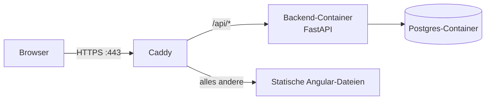

# SmartDesk – Deployment auf einem eigenen VPS

**Stand: 15.10.2026.** Dies ist eine Betriebsanleitung, kein Nachweis eines bereits erfolgten öffentlichen Deployments. Lokale Codeänderungen sind nicht automatisch auf GitHub oder dem Zielserver vorhanden. Für die lokale Demo und Entwicklung zuerst die [Startanleitung im Projekt-README](../README.md) lesen; die [Dokumentationsübersicht](README.md) ordnet die weiteren Dokumente ein.

Für die lokale Vorführung genügt die [Demo aus dem README](../README.md#demo-starten). Die bekannte Demo-Anmeldung und `docker-compose.demo.yml` gehören nicht auf einen öffentlichen Server. `DEMO_MODE` bleibt in der Produktionsumgebung `false`. Die folgenden Schritte beschreiben ein Deployment mit eigenen Zugangsdaten; noch offene Sicherheits- und Betriebsaufgaben stehen in den [bewussten Einschränkungen](architektur-und-konzepte.md#9-bewusste-einschränkungen--offene-punkte).

Diese Anleitung beschreibt den Weg auf einen eigenen Linux-Server mit Domain und automatischem HTTPS. Die Serverbefehle sind für Bash auf einem unterstützten Ubuntu-System gedacht, nicht für PowerShell auf deinem Windows-Rechner. Firewall, Benutzerrechte und Paketinstallation müssen zur tatsächlich verwendeten Umgebung passen.

## Architektur



Ein einziger Server, drei Docker-Container (Caddy, Backend, Postgres) plus die fertig gebauten Angular-Dateien, die Caddy direkt ausliefert. Caddy ist gleichzeitig Reverse Proxy (leitet `/api/*` ans Backend weiter) und Webserver für die statische Angular-App – und holt sich automatisch ein gültiges HTTPS-Zertifikat von Let's Encrypt, sobald eine echte Domain konfiguriert ist.

**Warum ein Server für beides statt getrennter Dienste?** Damit Frontend und Backend aus Browser-Sicht dieselbe Origin sind (keine unterschiedliche Domain/Port) – das vermeidet CORS und macht den Auth-Cookie trivial "same-site", ganz ohne die Cross-Origin-Konfiguration, die für getrennte Origins nötig wäre.

## Voraussetzungen

- Account bei einem VPS-Anbieter (Konditionen/Preise beim jeweiligen Anbieter selbst prüfen, ändern sich häufig)
- Ein SSH-Schlüsselpaar auf dem eigenen Rechner (`ssh-keygen`, falls noch keins existiert)
- Eine eigene Domain mit kontrollierbarer DNS-Konfiguration und Zugang zur Server-/Provider-Firewall

## Schritt 1: Server erstellen

Wähle ein von Docker unterstütztes Ubuntu-Release und prüfe Speicherbedarf von Frontendbuild, Containern, Datenbank und Backups unter der geplanten Last. Eine pauschale Mindestgröße ist hier nicht durch einen Lasttest belegt. Hinterlege den eigenen SSH-Public-Key und plane einen administrativen Benutzer mit gezielt verwendeten sudo-Rechten.

## Schritt 2: Erstzugriff & Grundabsicherung

```bash
ssh root@<server-ip>

# System aktuell halten
apt update && apt upgrade -y

# Firewall: nur SSH, HTTP, HTTPS erlauben
ufw allow OpenSSH
ufw allow 80/tcp
ufw allow 443/tcp
ufw enable
```

Vor Firewalländerungen einen funktionierenden SSH-Zugang absichern. Prüfe zusätzlich die Provider-Firewall. Veröffentlichte Dockerports können UFW-Regeln umgehen; die [offizielle Docker-Anleitung zu Ubuntu](https://docs.docker.com/engine/install/ubuntu/#firewall-limitations) beschreibt diese Einschränkung. Datenbank und Backend werden in der Produktions-Compose-Datei deshalb nicht als Hostports veröffentlicht.

## Schritt 3: Docker installieren

Installiere Docker Engine und das Compose-Plugin nach der [offiziellen Ubuntu-Anleitung über das Paketrepository](https://docs.docker.com/engine/install/ubuntu/#install-using-the-apt-repository). Docker empfiehlt das Convenience-Skript nicht für Produktionsumgebungen. Lade nicht ungeprüft ein externes Skript direkt in eine privilegierte Shell.

```bash
# Auf dem Zielserver: Installation und Zugriff auf den Docker-Daemon prüfen.
docker version
docker compose version
```

## Schritt 4: Domain auf den Server zeigen lassen

Bei echter Domain: beim Domain-Registrar (oder DNS-Anbieter) einen **A-Record** anlegen, der auf die Server-IP zeigt. DNS-Änderungen brauchen Zeit, um sich zu verbreiten (Minuten bis Stunden) – vor dem nächsten Schritt mit `dig <domain>` oder `nslookup <domain>` prüfen, ob die IP schon korrekt zurückkommt.

Prüfe auch vorhandene AAAA-Einträge: Eine falsche IPv6-Adresse kann Erreichbarkeit und Zertifikatsprüfung stören. Voraussetzungen und Verhalten der Zertifikatsbeschaffung stehen in [Caddys Dokumentation zu automatischem HTTPS](https://caddyserver.com/docs/automatic-https).

## Schritt 5: Projekt auf den Server holen

```bash
git clone https://github.com/okankpl/SmartDesk.git
cd SmartDesk
```

## Schritt 6: Produktions-`.env` anlegen

```bash
cp .env.example .env
nano .env   # oder ein anderer Editor
```

Werte, die sich gegenüber der lokalen Entwicklung ändern müssen:

```bash
# Echte, zufällige Werte statt der Beispielwerte - NIE die lokalen Dev-Werte wiederverwenden
POSTGRES_PASSWORD=<zufälliger Wert, z.B. per: python3 -c "import secrets; print(secrets.token_hex(24))">
# Enthält dasselbe Passwort ein zweites Mal (zwischen ":" und "@") - muss exakt zu
# POSTGRES_PASSWORD passen, sonst kommt das Backend nicht an die Datenbank
DATABASE_URL=postgresql+psycopg://smartdesk:<derselbe Wert wie POSTGRES_PASSWORD>@postgres:5432/smartdesk
SECRET_KEY=<zufälliger Wert, z.B. per: python3 -c "import secrets; print(secrets.token_hex(32))">

# Muss zur echten, kontrollierten Domain passen
FRONTEND_ORIGIN=https://smartdesk.example.com
COOKIE_SECURE=true
# Die bekannten lokalen Demo-Konten dürfen nicht automatisch angelegt werden.
DEMO_MODE=false
```

`token_hex` erzeugt nur Ziffern und die Buchstaben a–f. Das ist bei `POSTGRES_PASSWORD` wichtig: Zeichen wie `@`, `/` oder `:` hätten in `DATABASE_URL` eine eigene Bedeutung und müssten dort zusätzlich URL-kodiert werden.

Zusätzlich (für Caddy, siehe `docker-compose.prod.yml`):
```bash
DOMAIN=smartdesk.example.com
```

Das Backend prüft den `SECRET_KEY` beim Start: mit dem Platzhalter aus `.env.example` oder einem Wert unter 32 Zeichen startet es absichtlich nicht (siehe Troubleshooting). So kann ein vergessener Platzhalter nicht unbemerkt in Produktion landen.

## Schritt 7: Frontend bauen

Wird als statische Dateien gebaut, nicht als eigener Container betrieben – Caddy liefert die fertigen Dateien direkt aus. Ein Node-Container übernimmt den Build-Schritt, ohne Node auf dem Server selbst installieren zu müssen:

```bash
docker run --rm -v "$(pwd)/frontend:/app" -w /app "node:$(cat frontend/.nvmrc)" sh -c "npm ci && npx ng build --configuration production"
```

Die Node-Version steht zentral in `frontend/.nvmrc` und gilt genauso für die CI und `scripts/deploy.sh`. Angular 22 läuft erst ab Node 22.22 bzw. 24.15; unter Node 20 bricht der Build sofort mit Exit-Code 3 ab.

Ergebnis liegt danach in `frontend/dist/frontend/browser/` – genau der Pfad, den `docker-compose.prod.yml` in den Caddy-Container mountet.

## Schritt 8: Stack starten

```bash
docker compose -f docker-compose.prod.yml build
docker compose -f docker-compose.prod.yml run --rm backend alembic upgrade head
docker compose -f docker-compose.prod.yml up -d
```

Die Reihenfolge ist bewusst gewählt: erst das Backend-Image bauen, dann die Datenbank-Migrationen mit genau diesem Image in einem einmaligen Container ausführen (`run --rm`; startet Postgres bei Bedarf automatisch mit), erst danach alles starten. So läuft neuer Code nie gegen ein veraltetes Datenbankschema. `scripts/deploy.sh` macht bei späteren Updates dasselbe.

Caddy braucht beim allerersten Start etwas Zeit, um das Let's-Encrypt-Zertifikat zu holen – Fortschritt in den Logs verfolgen:

```bash
docker compose -f docker-compose.prod.yml logs -f caddy
```

## Schritt 9: Testen

- `https://<domain>/api/health` → `{"status":"ok"}` (der Backend-Prozess läuft)
- `https://<domain>/api/health/ready` → `{"status":"ok","database":"ok"}` (das Backend erreicht auch die Datenbank – `503` heißt: `DATABASE_URL` prüfen)
- `https://<domain>/api/docs` → Swagger UI
- `https://<domain>/` → Login-Seite

Ein Konto über `/register` oder die Swagger UI (`POST /api/auth/register`) anlegen und über die Oberfläche anmelden. Neue Konten sind Mitarbeitende; es gibt noch keine Rollenverwaltung in der UI. Die bekannten lokalen Demo-Konten werden in Produktion nicht erzeugt.

Sicherheits-Header prüfen (setzt das `Caddyfile`):

```bash
curl -sI https://<domain>/ | grep -iE "strict-transport|content-security|x-frame|x-content-type"
```

Auf der Frontendantwort sollten alle vier Header erscheinen; die CSP ist im Caddyfile bewusst nur für das Frontend gesetzt, nicht für die Swagger-Seite. Fehlen Header, Konfiguration und laufenden Container prüfen und nach einer bestätigten Korrektur Caddy neu starten.

## Produktions-Setup vorab lokal testen

Die komplette Produktions-Konfiguration (Caddy, Sicherheits-Header, `--root-path`, Container ohne root) lässt sich vor dem Deployment auf dem eigenen Rechner prüfen – als **separates Compose-Projekt** (`-p`), damit eigene Container und Volumes entstehen und die lokale Entwicklungsumgebung unberührt bleibt. Caddy stellt für `localhost` automatisch ein selbstsigniertes Zertifikat aus (Browser-Warnung ist hier erwartet, `curl` braucht `-k`):

```bash
# Zunächst im Frontendverzeichnis die statischen Dateien bauen.
cd frontend
npm ci
npm run build
cd ..

# Getrenntes Compose-Projekt: erst bauen und migrieren, dann den Stack starten.
DOMAIN=localhost docker compose -p smartdesk-prodtest -f docker-compose.prod.yml build
DOMAIN=localhost docker compose -p smartdesk-prodtest -f docker-compose.prod.yml run --rm backend alembic upgrade head
DOMAIN=localhost docker compose -p smartdesk-prodtest -f docker-compose.prod.yml up -d

curl -k https://localhost/api/health                     # {"status":"ok"}
curl -k https://localhost/api/health/ready               # {"status":"ok","database":"ok"}
curl -skI https://localhost/ | grep -i content-security  # CSP vorhanden

# Aufraeumen - -v entfernt nur die Volumes DIESES Test-Projekts
DOMAIN=localhost docker compose -p smartdesk-prodtest -f docker-compose.prod.yml down -v
```

Unter Windows/PowerShell statt `DOMAIN=localhost ...` vorher `$env:DOMAIN = "localhost"` setzen. Voraussetzung: Ports 80 und 443 sind lokal frei.

## Troubleshooting

| Symptom | Wahrscheinliche Ursache |
|---|---|
| Zertifikat wird nicht ausgestellt / Caddy-Logs zeigen Timeout | DNS zeigt noch nicht (richtig) auf die Server-IP, oder Port 80/443 ist irgendwo blockiert (Cloud-Firewall vs. `ufw` – beide prüfen) |
| `502 Bad Gateway` von Caddy | Backend-Container läuft nicht/ist noch am Starten - `docker compose -f docker-compose.prod.yml ps` und `logs backend` prüfen |
| `/api/health` sagt `ok`, aber `/api/health/ready` gibt `503` und jede echte Anfrage `500` | Backend kommt nicht an die Datenbank – meist passt das Passwort in `DATABASE_URL` nicht zu `POSTGRES_PASSWORD` (siehe Schritt 6). Achtung: Postgres übernimmt `POSTGRES_PASSWORD` nur beim allerersten Start mit leerem Volume, ein späteres Ändern in `.env` ändert das Passwort in der Datenbank NICHT |
| Backend startet nicht, Log zeigt `SECRET_KEY ist der Platzhalter ...` | `SECRET_KEY` in `.env` ist noch der Beispielwert oder zu kurz – neuen Wert erzeugen (siehe Schritt 6), danach `docker compose -f docker-compose.prod.yml up -d backend` |
| Swagger UI unter `/api/docs` bleibt leer ("Failed to load API definition") | Backend läuft ohne `--root-path /api` (siehe `command` in `docker-compose.prod.yml`) und sucht die API-Beschreibung deshalb unter `/openapi.json` statt `/api/openapi.json` |
| Login funktioniert, aber Cookie kommt nicht an | `FRONTEND_ORIGIN`/`COOKIE_SECURE` in `.env` stimmen nicht mit der echten Domain überein, oder Seite wurde über `http://` statt `https://` aufgerufen |
| Seiten-Reload auf z.B. `/dashboard` gibt 404 | `try_files` im `Caddyfile` fehlt/falsch – sollte auf `index.html` zurückfallen (SPA-Routing) |

## Laufender Betrieb

Die Einzelschritte aus Schritt 7/8 oben (Frontend bauen, Container neu bauen, Migrationen anwenden) sind für spätere Updates als Skript zusammengefasst – nach dem allerersten Deployment reicht:

```bash
./scripts/deploy.sh
```

Das Skript endet mit einem Health-Check gegen `/health/ready` (von innerhalb des Backend-Containers, weil Port 8000 in Produktion nicht nach außen freigegeben ist) und meldet einen Fehler, wenn Backend oder Datenbank nach 20 Sekunden nicht bereit sind.

**Datenbank-Backup** (Postgres-Daten liegen im Docker-Volume `postgres_data` – bei einem Server-Verlust ohne Backup sind sie weg):
```bash
./scripts/backup.sh
```
Legt eine Datei unter `backups/` an (ist in `.gitignore` – die Datei enthält E-Mail-Adressen und Passwort-Hashes aller Nutzer) und entfernt automatisch Backups, die älter als 7 Tage sind. Für automatische, regelmäßige Backups siehe den Cron-Hinweis am Ende des Skripts.

Wiederherstellen ist destruktiv: Das vom Skript erzeugte SQL enthält Löschanweisungen für vorhandene Objekte. Verwende nur ein geprüftes Backup und teste den Restore zuerst in einer getrennten Umgebung. Ein bloß vorhandenes Backup ist kein belegter Wiederherstellungserfolg.
```bash
# Bash auf dem Zielserver, nicht PowerShell: Fiktiven Namen durch die echte Sicherung ersetzen.
backup_file='backups/smartdesk-YYYYMMDD-HHMMSS.sql'
# Vor dem destruktiven Restore sicherstellen, dass die ausgewählte Datei lesbar ist.
test -r "$backup_file" || { printf '%s\n' 'Backup nicht lesbar; Restore abgebrochen.' >&2; exit 1; }
# -v ON_ERROR_STOP=1 beendet psql beim ersten SQL-Fehler; nicht atomar ohne weitere Optionen.
docker compose -f docker-compose.prod.yml exec -T postgres \
  sh -c 'psql -v ON_ERROR_STOP=1 -U "$POSTGRES_USER" -d "$POSTGRES_DB"' < "$backup_file"
```

Die Backups liegen auf demselben Server wie die Datenbank – fällt der Server komplett aus, sind beide weg. Für echten Schutz regelmäßig eine Kopie an einen anderen Ort ziehen (z.B. per `scp` auf den eigenen Rechner).

**Erreichbarkeit überwachen:**
```bash
./scripts/healthcheck.sh https://<domain>/api/health/ready
```
Einfaches Beispiel für automatisiertes Monitoring – schreibt bei einem Ausfall ins System-Log. Für den Cron-Job siehe den Hinweis am Ende des Skripts. Für mehr als "läuft es noch" (Metriken, Dashboards, Benachrichtigungen) sind dedizierte Tools wie Uptime Kuma oder Prometheus/Grafana der nächste Schritt.
