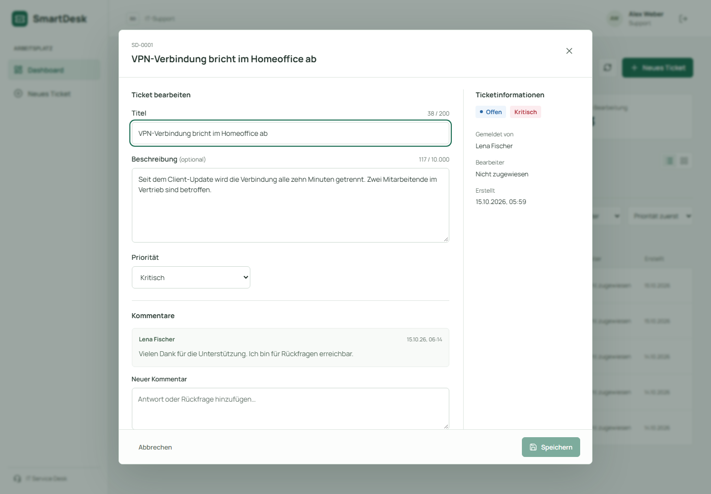

# Entscheidungen: Zuständigkeit, Historie und Demo

Stand: 15.10.2026. Diese Entscheidungen ergänzen die [Architekturbeschreibung](architektur-und-konzepte.md).

## Zuständigkeit als Fachregel

Ein Rollencheck allein verhindert nicht, dass zwei Agents denselben Fall bearbeiten. Deshalb ist die Rolle nur die erste Bedingung; zusätzlich gelten Regeln am konkreten Ticket:

| Aktion | Mitarbeitende | Agent | Admin |
| --- | --- | --- | --- |
| Lesen / kommentieren / Verlauf lesen | Eigene Tickets | Alle Tickets | Alle Tickets |
| Offenes Ticket übernehmen | Nein | Nicht oder selbst zugewiesen | Auch fremd zugewiesen |
| In Bearbeitung → gelöst | Nein | Nur als eingetragener Bearbeiter | Ja, auch vertretend |
| Lösung ablehnen | Nur als Melder | Nein | Ja |
| Gelöst → geschlossen | Nein | Nein | Ja |
| An andere delegieren | Nein | Nein | Ja |
| Titel / Beschreibung / Priorität ändern | Nein | Außer bei geschlossenen Tickets | Außer bei geschlossenen Tickets |
| Ticket löschen | Nein | Nein | Ja |

Übernehmen setzt `assignee_id` auf den handelnden Nutzer. Zuweisungen sind nur an Agents/Admins möglich. Ein bereits bearbeitetes Ticket darf nicht ohne Bearbeiter zurückbleiben. Bei Ablehnung bleibt der Bearbeiter erhalten und `resolved_at` wird geleert. Geschlossene Tickets sind für Inhalts- und Zuständigkeitsänderungen gesperrt; Kommentare bleiben entsprechend der bisherigen Regel möglich.

Die ausführbaren Übergänge und die API-Prüfung nutzen dieselbe Funktion `get_allowed_next_statuses`. Damit stimmen sichtbare Aktionen und tatsächlich erlaubte Statuswechsel überein. Die reine Fachlogik kennt keine HTTP-Statuscodes; der zentrale Fehlerhandler übersetzt ihre Fehler.

## Gleichzeitige Änderungen

Eine Abfolge aus Lesen, Prüfen und Schreiben ist ohne Sperre anfällig: Zwei Requests können gleichzeitig ein offenes Ticket lesen und beide erfolgreich übernehmen. `PATCH` lädt das Ticket deshalb mit `SELECT … FOR UPDATE OF tickets`. Die Sperre gilt bis zum Commit/Rollback. Ein zweiter Request wartet und prüft danach den inzwischen aktuellen Zustand. Bei einer zweiten Übernahme passt der Übergang nicht mehr, daher `409 Conflict`.

`OF tickets` ist relevant, weil Namen über äußere JOINs auf Nutzer geladen werden. Gesperrt wird gezielt die Ticketzeile, nicht die nullable Seite dieser JOINs. Ein PostgreSQL-Integrationstest hält die Zeile zunächst selbst gesperrt und prüft, dass beide Requests warten; nach Freigabe entstehen genau ein Gewinner und ein Historieneintrag.

Die Sperre allein erkennt keinen veralteten Entwurf aus einem länger geöffneten Dialog. Deshalb hat jedes Ticket zusätzlich einen ganzzahligen Versionszähler. SQLAlchemy verwaltet ihn über [`version_id_col`](https://docs.sqlalchemy.org/en/20/orm/versioning.html); Inhalts-, Status- und Zuweisungsänderungen erhöhen ihn bei einem tatsächlichen UPDATE. Unveränderte Felder erhöhen ihn nicht. Die Migration `b42e8f19a620` versieht bestehende Tickets mit Version 1.

Editor und Zuweisungsformular senden die gelesene Version als `expected_version` an `PATCH /tickets/{id}`. Nach dem Sperren vergleicht der Server sie mit dem aktuellen Stand. Bei einer Abweichung antwortet er mit `409`, bevor Felder oder Historie geändert werden. Ein weiterer PostgreSQL-Konkurrenztest erzwingt zwei wartende Inhaltsänderungen auf derselben Ausgangsversion: Nur eine wird gespeichert. Ein ORM-seitig erkannter Versionskonflikt wird ebenfalls als `409` beantwortet.

Das Feld bleibt für bestehende API-Clients optional. Diese Kompatibilitätsentscheidung ist eine bewusste Grenze: Ohne `expected_version` prüft der Server zwar Rollen und Fachregeln, erkennt aber keinen veralteten Client-Entwurf. Direkte SQL-Schreibzugriffe liegen ebenfalls außerhalb der ORM-Versionsverwaltung. Kommentare verändern die Ticketversion nicht, weil sie keine Ticketfelder überschreiben.

## Inhaltseditor

Der Detaildialog stellt für Agents/Admins bei nicht geschlossenen Tickets einen Editor bereit. Er sendet nur tatsächlich geänderte Inhaltsfelder, nie Melder, Status oder Zuständigkeit. Die Zuständigkeit bleibt ein eigener Ablauf. Während eines Schreibzugriffs sind konkurrierende Aktionen im selben Dialog gesperrt.

Ein Kommentarentwurf bleibt beim Wechsel in und aus dem Editor bestehen. Beim Schließen oder Abbrechen mit geänderten Inhalten wird das Verwerfen explizit bestätigt. Bei Netzwerk-/Serverfehlern bleibt der Entwurf erhalten. Nach einem Versionskonflikt ist Speichern gesperrt; „Entwurf verwerfen und neu laden“ übernimmt ausdrücklich den aktuellen Serverstand, bevor erneut bearbeitet werden kann. Ein inzwischen geschlossenes Ticket beendet den Editor.

## Anwendungshistorie

`ticket_events` speichert Ticket, handelnde Person, Ereignistyp, Zeitpunkt und ein JSONB-Objekt mit Vorher-/Nachher-Werten. Ein Ereignis wird in derselben SQLAlchemy-Session wie die fachliche Änderung angelegt. Erst ein gemeinsames Commit macht beide dauerhaft sichtbar. Abgelehnte Aktionen und unveränderte PATCH-Felder erzeugen keine Ereignisse.

Es gibt drei Ereignistypen: `created`, `updated` und `status_changed`. Kommentare haben ihre eigene Tabelle; sie werden nicht zusätzlich als Änderung dupliziert. Der Verlauf wird über `GET /tickets/{id}/history` gelesen, unter derselben Sichtbarkeitsregel wie das Ticket. Ein JOIN lädt die Namen in einer Abfrage, statt eine Abfrage je Ereignis auszuführen.

Die neue Migration rekonstruiert keine unbekannte Vergangenheit bestehender Tickets. Ein leerer Verlauf ist deshalb zulässig. Autorennamen werden aus dem aktuellen Nutzerprofil gelesen, nicht historisch eingefroren. IDs und Vorher-/Nachher-Werte bilden die gespeicherten Fakten.

Die API bietet kein Ändern/Löschen einzelner Ereignisse. Das ist eine Anwendungshistorie, keine manipulationssichere Buchführung: direkte Datenbankzugriffe bleiben möglich, und das Löschen des Tickets entfernt die zugehörigen Ereignisse per Fremdschlüssel-Cascade.

## Demo und Produktion trennen

`docker-compose.demo.yml` hat einen eigenen Projektnamen, eigene Datenbank und ein eigenes Volume. Die bekannten Demo-Passwörter und der Demo-Signierschlüssel gehören nur zu dieser Konfiguration. Ausschließlich der Webserver ist auf den Loopback-Adressen des Hosts erreichbar; Backend und Datenbank sind intern.

Der einmalige `setup`-Dienst wartet auf PostgreSQL, führt Migrationen aus und startet dann `python -m app.seed_demo`. Der Seeder verlangt `DEMO_MODE=true`, akzeptiert nur eine leere Datenbank beziehungsweise den unveränderten historischen Migrations-Platzhalter und überschreibt keine bestehenden Konten oder Tickets. Die produktive Konfiguration aktiviert den Seeder nicht.

Das Frontend wird im mehrstufigen Docker-Build mit Node gebaut und als fertige Dateien durch Caddy ausgeliefert. Es verwendet denselben `/api`-Reverse-Proxy und dieselben Header wie die Produktionskonfiguration. Node, npm und Entwicklungsserver laufen nicht im fertigen Frontend-Container.

## Nachweise

- Unit-Tests prüfen Statusübergänge, Zuweisung, Eingaben, Auth und Fehlerzuordnung.
- HTTP-Tests prüfen Cookie-Login, Registrierung ohne Rolleneskalation, Zugriff auf fremde IDs, vollständigen Lifecycle, Namen, Cascade-Löschung und Transaktionsverhalten.
- Konkurrierende Übernahme- und Inhaltsänderungs-Tests prüfen echte PostgreSQL-Zeilensperren und Versionskonflikte.
- `alembic upgrade head` und `alembic check` prüfen Aufbau und Modelldrift.
- Angular läuft mit strengen TypeScript- und Template-Prüfungen; Komponenten-/Service-Tests prüfen unter anderem Registrierung, Filter und den Historien-Fehlerfall.
- Playwright prüft Registrierung und den vollständigen Rollenablauf gegen den Container-Stack auf Desktop und Mobile, einschließlich horizontalem Überlauf, Inhaltseditor, Verwerfen von Entwürfen, Versionskonflikten und Fehlern im Browser.

Die Workflows sind im Repository konfiguriert. Ein erfolgreicher lokaler Lauf ist unabhängig vom späteren Status der GitHub-Actions-Läufe.
